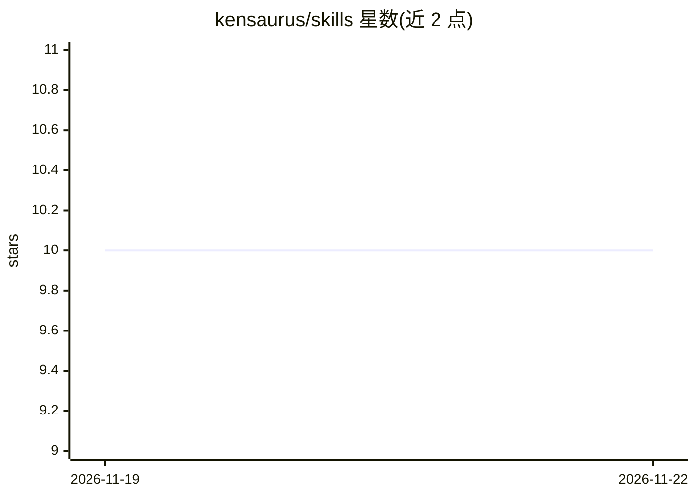

# kensaurus/skills

⭐ 10 · JavaScript · MIT · 推送 2026-11-17 · [GitHub](https://github.com/kensaurus/skills) · [官网](https://kensaurus.github.io/skills/) · 个人维护

**为编码 agent 安装 162 个技能与 63 条斜杠命令的工具包**

以 SKILL.md 技能包形式分发的 agent 工作流合集：安装器为一个 Node 脚本，检测机器上的 Claude Code、Cursor、Codex CLI、Gemini CLI 等并将技能、命令、子代理与规则写入各工具的用户目录。技能按 core/web/backend/mobile/growth/maintain 六个 profile 组织，支持合并安装、--prune 裁剪与哈希校验；安装后用户用自然语言描述任务，/kenji 命令匹配对应 playbook 并执行。写入前预览、有备份与回滚路径。

## 筛选速览

| 维度 | 判定 | 备注 |
|---|---|---|
| AI 角色 | `ai-knowledge` | 知识聚合/清单类 |
| 许可风险 | `permissive` | MIT |
| 部署形态 | `library` | 以包/库形式分发 |
| 模型依赖 | — | README 未给出锁定关系 |
| 硬件要求 | — | 无带数字的原话,不猜 |
| 安装摩擦 | `low` | 无编译、无系统依赖或容器化 |
| 成熟度 | — | 结构信号不足 |

## 能力要点

- 162 个技能、63 条斜杠命令、6 个子代理与 MCP 模板，按六个 profile 组织
- 支持 Claude Code、Cursor、Codex CLI、Gemini CLI、Antigravity CLI 及任何读取 SKILL.md 的 agent
- 合并式安装：保留用户已有文件，写入后逐文件哈希校验，--clean 前自动备份
- 安装器为无依赖 Node 脚本，无网络连接、无子进程、无 npm 生命周期脚本

## 适用场景

- 在 React/Next.js/Supabase 项目中让 agent 按既定工作流修 bug 并开 PR
- 为多个 AI 编码工具一次性统一安装同一套技能与规则
- 按需裁剪技能数量以减少 agent 每次会话加载的描述列表

## 场景标签

`编码 Agent` `提示工程` · 领域:Agent 开发

## 证据(README 行号)

> L5: **You say the job. The playbook runs.** Agent skills, slash commands, and subagents for Claude Code, Cursor, Codex C
> L7: 162 agent skills · 63 slash commands · 6 subagents · MCP templates. Written on React, Next.js, and Supabase projects
> L71: A profile install is a merge: skills you installed earlier stay. Add `--prune` to remove this pack's skills that ar

## 星数曲线

2026-11-19 10 → 2026-11-22 10（+0）

---
*卡片 v1 · prompt 1.4 · 生成 2026-11-19 · 置信度 high · 依据 README sha `de1e40903536` · [字段定义](../../DATASET.md)*
