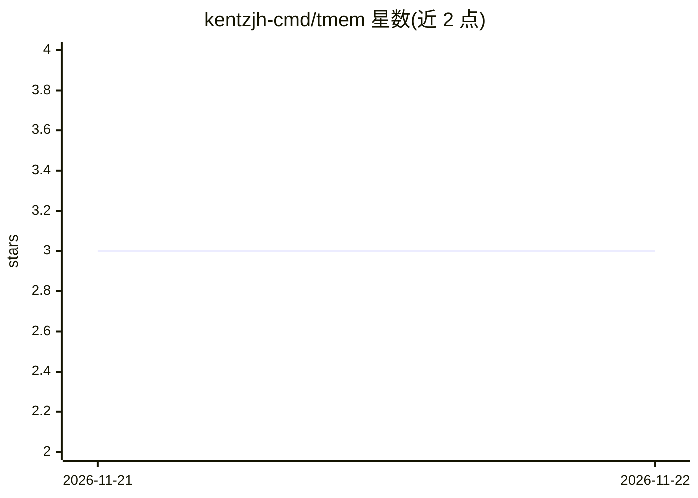

# kentzjh-cmd/tmem

⭐ 3 · JavaScript · MIT · 推送 2026-11-21 · [GitHub](https://github.com/kentzjh-cmd/tmem) · 个人维护 · 中文 README

**给 Coding Agent 的本地记忆插件：压缩存档、按需翻历史**

配合 @deepseek-ai/dsh (DeepSeek Harness) 的本地代码记忆插件，npm 包名 dsh-tmem，纯 Node.js 实现、零第三方依赖，数据存在项目 .tmem/ 目录。监听 DSH 的压缩与输出截断事件，自动把完整会话现场存进 episodes/，并内联一份极短索引，由模型通过注册的 tmem_search/tmem_expand 工具按需分四层（目录/梗概/逐轮/全量）召回。不调用 LLM 做总结，用倒推裁剪保留关键步骤；注入经验前用 AST 签名检查失效过时记忆。仅支持 dsh 运行时。

## 筛选速览

| 维度 | 判定 | 备注 |
|---|---|---|
| AI 角色 | `ai-ecosystem` | LLM/agent 周边工具 |
| 许可风险 | `permissive` | MIT |
| 部署形态 | `library` | 以包/库形式分发 |
| 模型依赖 | locked-api |  |
| 硬件要求 | — | 无带数字的原话,不猜 |
| 安装摩擦 | `low` | 无编译、无系统依赖或容器化 |
| 成熟度 | — | 结构信号不足 |

## 能力要点

- 压缩/截断时自动存档完整会话历史，支持时间线串联与全量回放
- 不调用 LLM 总结，从真实操作记录倒推裁剪关键步骤
- AST 函数签名检查自动降级重构后的过时经验
- 支持 Python/JS/TS/Go/Rust 等语言的函数签名指纹提取

## 适用场景

- Coding Agent 长对话压缩后找回丢失的方案、改动与报错细节
- 团队把典型 Bug 修复经验提炼成可提交 Git 的共享手册
- 重构后防止旧记忆误导模型写错调用方式

## 场景标签

`编码 Agent` `Agent 记忆` · 领域:Agent 开发

## 证据(README 行号)

> L7: `tmem`（npm 包名 `dsh-tmem`）是一个专门配合 `@deepseek-ai/dsh` (DeepSeek Harness) 使用的本地代码记忆插件，纯 Node.js 实现、零外部依赖，所有记录都存在当前仓库的 `
> L138: 1. **只管 DeepSeek Harness (`dsh`)**：为了做深做透，运行时钩子和压缩监听只针对 `@deepseek-ai/dsh` 打磨（`swe_bench` 适配器只是为了跑上面的开源评测）。

## 星数曲线

2026-11-21 3 → 2026-11-22 3（+0）

---
*卡片 v1 · prompt 1.4 · 生成 2026-11-21 · 置信度 high · 依据 README sha `3106a4dc01fc` · [字段定义](../../DATASET.md)*
