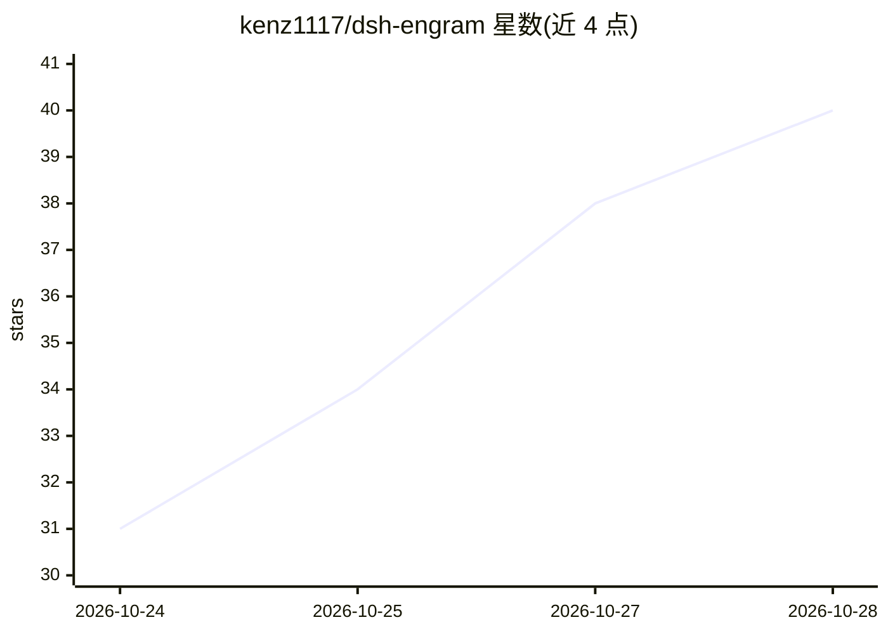

# kenz1117/dsh-engram

⭐ 40 · TypeScript · MIT · 推送 2026-10-25 · [GitHub](https://github.com/kenz1117/dsh-engram) · [官网](https://kenz1117.github.io/dsh-engram/) · 个人维护 · 中文 README

**DeepSeek Harness 的本地跨会话长期记忆插件（记忆宫殿架构）**

面向 DeepSeek Harness 编码 agent 的 SQLite 本地长期记忆插件：零外部服务、零 API Key、零 Docker，一条命令安装。提供 23 个窄参数工具覆盖保存、混合检索（FTS5 + 本地向量 RRF 融合）、事实链、时间线、蒸馏、信念巩固与 SM-2 间隔重复复习；以记忆宫殿信息架构组织记忆（房间#桩位坐标、固定巡游路线、门牌评分），双层分库（用户全局库 + 按 git origin 隔离的项目库）。含证据门（search→assess 三条件代码强制）、来源三级审计、提示注入防护与入库脱敏，附中英俄文 Web 管理面板与 Markdown/JSON/Obsidian 镜像导出。默认嵌入模型为 Xenova paraphrase-multilingual-MiniLM（离线运行，失败降级纯关键词）。

## 筛选速览

| 维度 | 判定 | 备注 |
|---|---|---|
| AI 角色 | `ai-ecosystem` | LLM/agent 周边工具 |
| 许可风险 | `permissive` | MIT |
| 部署形态 | `library` | 以包/库形式分发 |
| 模型依赖 | locked-api |  |
| 硬件要求 | — | 无带数字的原话,不猜 |
| 安装摩擦 | `low` | 无编译、无系统依赖或容器化 |
| 成熟度 | — | 结构信号不足 |

## 能力要点

- 23 个窄参数工具覆盖记忆保存/检索/审计/蒸馏/复习全生命周期
- FTS5 + 本地向量（384 维 q8）RRF 混合检索，嵌入离线运行、失败自动降级
- 证据门 engram_assess 由代码强制三条件齐备才判检索充足
- SM-2 间隔重复复习：只给宫殿坐标与门牌线索、不给正文，先回忆后揭示
- 双层分库：user.db 全局 + project-<hash>.db 按 git origin 隔离

## 适用场景

- 让编码 agent 跨会话记住我的偏好与项目约定
- 在多项目工作区中隔离各仓库的项目记忆
- 把会话历史回填为结构化记忆库并做间隔重复巩固
- 导出记忆为 Markdown/Obsidian 镜像作为可读知识库

## 场景标签

`Agent 记忆` · 领域:Agent 开发

## 证据(README 行号)

> L5:  Local-first long-term memory for your coding agent.
> L27: dsh plugin --profile web add @kenz1117/dsh-engram
> L129: ## 工具（23 个，窄参数）

## 星数曲线

2026-10-24 31 → 2026-10-28 40（+9）

---
*卡片 v1 · prompt 1.4 · 生成 2026-10-25 · 置信度 high · 依据 README sha `9268817f1f8b` · [字段定义](../../DATASET.md)*
