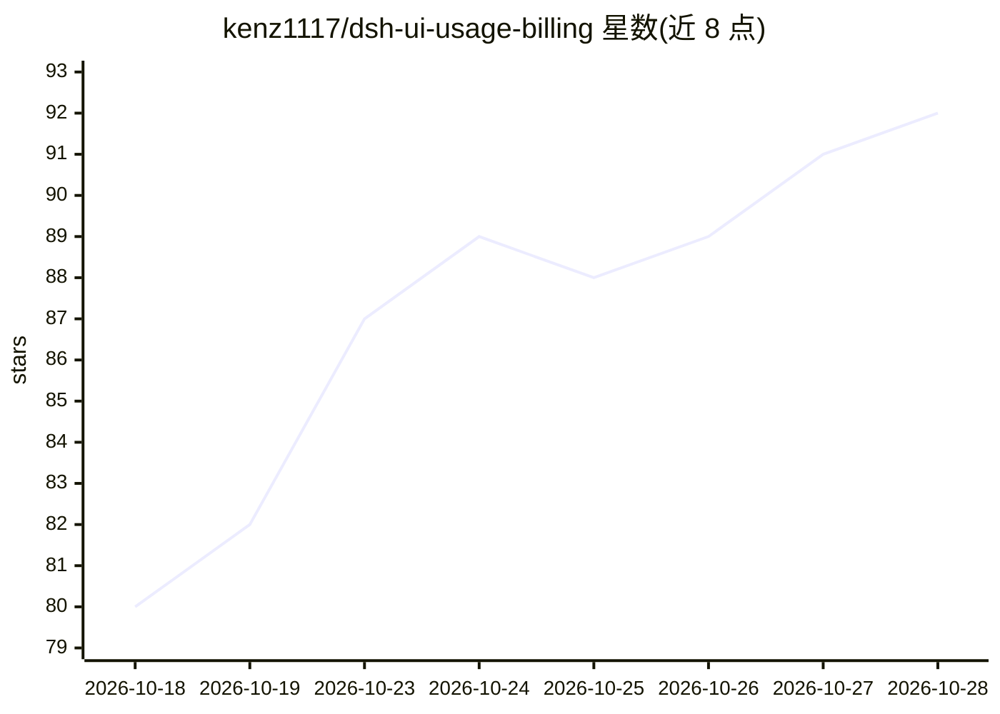

# kenz1117/dsh-ui-usage-billing

⭐ 92 · TypeScript · MIT · 推送 2026-10-27 · [GitHub](https://github.com/kenz1117/dsh-ui-usage-billing) · [官网](https://www.npmjs.com/package/@kenz1117/dsh-ui-usage-billing) · 个人维护 · 中文 README

**DeepSeek Harness 的用量计费仪表盘插件**

面向 DeepSeek Harness（DSH）宿主的计费与用量可视化插件：服务端遍历持久化会话日志聚合真实用量，结合 models.dev 实时目录与内置 25 厂商 239 款模型价目计算费用，支持 DeepSeek 分时峰谷计价、自定义单价、多厂商余额与订阅额度查询、余额差对账；浏览器端提供八区仪表盘、热力图、性能指标（TTFT/生成速度）与 CSV/JSON 导出。兼容多个 DSH 代际，经 npm 与 DSH Community Market 两种途径安装。

## 筛选速览

| 维度 | 判定 | 备注 |
|---|---|---|
| AI 角色 | `ai-ecosystem` | LLM/agent 周边工具 |
| 许可风险 | `permissive` | MIT |
| 部署形态 | `library` | 以包/库形式分发 |
| 模型依赖 | — | README 未给出锁定关系 |
| 硬件要求 | — | 无带数字的原话,不猜 |
| 安装摩擦 | `low` | 无编译、无系统依赖或容器化 |
| 成熟度 | — | 结构信号不足 |

## 能力要点

- 从持久化会话日志实时聚合真实用量，与官方余额当日变动交叉对账
- 内置 25 厂商 239 款模型价目，支持 DeepSeek 分时峰谷分段计价与自定义单价
- 多厂商余额、订阅套餐额度与中转站滚动额度查询及预警
- 默认零工具注入，不注入系统提示、不写模型可见事件

## 适用场景

- 在 DSH 宿主侧边栏查看每日/每周/每月模型开销
- 为多模型多中转站的使用做对账与预算提醒
- 查看各模型 TTFT 与生成速度等性能指标
- 导出按日/按会话/按站点的费用统计报表

## 场景标签

`LLM 可观测性` · 领域:评测与运维

## 证据(README 行号)

> L158:   ├─ GET /api/billing/usage-stats ────────▶ ├─ sessionPersistence 遍历持久化会话日志
> L162: - **服务端**（`src/index.ts`）：注入 `webServer`、`sessionPersistence` 与 `credentials`，注册 `GET /api/billing/usage-stats`、`/

## 星数曲线

2026-10-18 80 → 2026-10-28 92（+12）

---
*卡片 v1 · prompt 1.4 · 生成 2026-10-23 · 置信度 high · 依据 README sha `0ddff2805ec5` · [字段定义](../../DATASET.md)*
