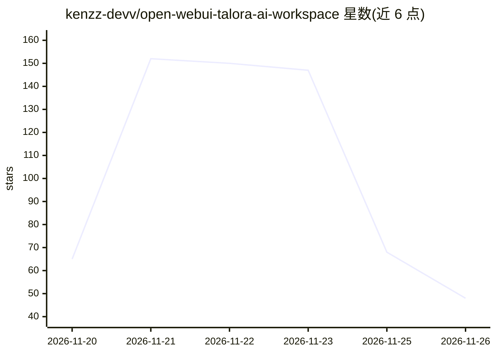

# kenzz-devv/open-webui-talora-ai-workspace

⭐ 48 · TypeScript · MIT · 推送 2026-11-25 · [GitHub](https://github.com/kenzz-devv/open-webui-talora-ai-workspace) · 个人维护

**面向团队的多模型 AI 工作区：统一管理对话、模型与文档**

一个模型无关的 Web 工作区应用，将对话界面、工作区组织与模型编排集中在一个界面中。用户可接入自选的模型端点，在会话中切换与比较模型，将文件作为上下文引用，并把对话按命名工作区归类；提供提示词库、模板预填、基于角色的权限管理、会话隔离与历史检索。要求 Windows 10/11 与 PowerShell 5.1+，通过 PowerShell 脚本安装，数据采用本地存储。

## 筛选速览

| 维度 | 判定 | 备注 |
|---|---|---|
| AI 角色 | `ai-ecosystem` | LLM/agent 周边工具 |
| 许可风险 | `permissive` | MIT |
| 部署形态 | `None` |  |
| 模型依赖 | — | README 未给出锁定关系 |
| 硬件要求 | — | 无带数字的原话,不猜 |
| 安装摩擦 | `low` | 无编译、无系统依赖或容器化 |
| 成熟度 | — | 结构信号不足 |

## 能力要点

- 多模型切换与响应比较，模型选择器即时生效
- 文件附件与上下文范围控制，回复基于所附文档
- 工作区组织、提示词库与会话内模板预填
- 管理员权限管理、模型暴露设置与组级默认配置

## 适用场景

- 围绕一组参考文档开展带来源的研究会话并按项目归档
- 为重复性写作任务保存并复用标准提示模板
- 管理员统一控制团队成员可用的模型与功能
- 按工作区或关键词检索并回溯历史回答

## 场景标签

`聊天机器人` `提示工程` · 领域:Agent 开发

## 证据(README 行号)

> L12: Open Webui Talora Ai Workspace is a refined, model-agnostic environment built for teams that expect their AI toolin
> L47: **Connect your intelligence layer.** Point the workspace at your preferred model provider and it immediately establ

## 星数曲线

2026-11-20 65 → 2026-11-26 48（-17）

---
*卡片 v1 · prompt 1.4 · 生成 2026-11-20 · 置信度 mid · 依据 README sha `8a630eb12429` · [字段定义](../../DATASET.md)*
