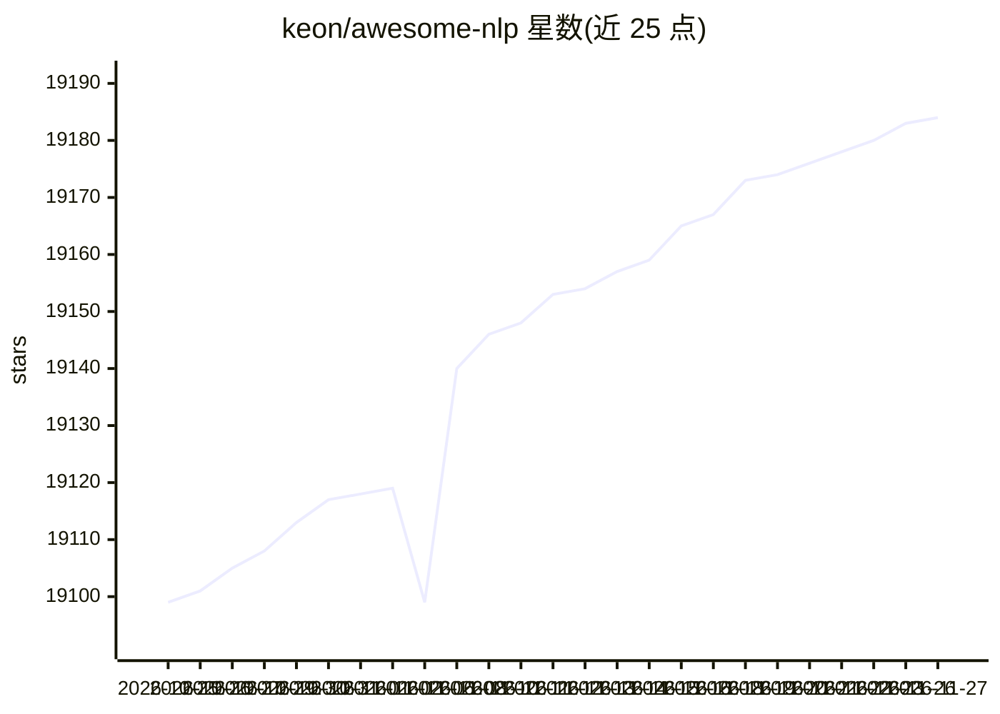

# keon/awesome-nlp

⭐ 19,184 · CC0-1.0 · 推送 2026-11-20 · [GitHub](https://github.com/keon/awesome-nlp) · 个人维护

**NLP 学习与研究资源策展清单，覆盖论文/教程/库**

按贡献指南由社区以 pull request 维护的 NLP 资源清单，范围限定于语言分析、多语言工具、经典与神经方法、数据集与评测；大模型内容仅收录与核心 NLP 任务相关的部分，通用聊天机器人、agent 框架与提示模板仓库被明确排除并指向其他清单。内容分为研究动态汇总（ACL Anthology、NLP-Progress 等）、知名研究实验室、教程/课程/书籍与多语言库目录（Node.js/Python 等）。

## 筛选速览

| 维度 | 判定 | 备注 |
|---|---|---|
| AI 角色 | `ai-knowledge` | 知识聚合/清单类 |
| 许可风险 | `viral` | CC0-1.0 |
| 部署形态 | `None` |  |
| 模型依赖 | — | README 未给出锁定关系 |
| 硬件要求 | — | 无带数字的原话,不猜 |
| 安装摩擦 | `low` | 无编译、无系统依赖或容器化 |
| 成熟度 | — | 结构信号不足 |

## 动量与使用信号

- 维护:`active` — 距上次 push 5.4 天,年发版 0,146 位贡献者
- 涨星:近 1 天 **+2**(自 20261016 起算)

## 能力要点

- 覆盖论文档案、SOTA 追踪、课程、书籍与多语言库的单一清单
- 明确收录范围：仅限核心 NLP 任务相关的大模型内容
- 社区以 pull request 方式持续补充条目

## 适用场景

- 查找某类 NLP 任务的开源库或工具
- 系统学习 NLP 时挑选课程与教材
- 跟进 NLP 研究动态与榜单资源

## 场景标签

`精选清单` · 领域:学习与行业

## 证据(README 行号)

> L5: A curated list of resources dedicated to Natural Language Processing
> L11: This list covers natural language processing — linguistic analysis, multilingual tooling, classical and neural meth

## 星数曲线

2026-10-25 19,099 → 2026-11-27 19,184（+85）

---
*卡片 v1 · prompt 1.4 · 生成 2026-11-22 · 置信度 high · 依据 README sha `47c82d1c46d0` · [字段定义](../../DATASET.md)*
