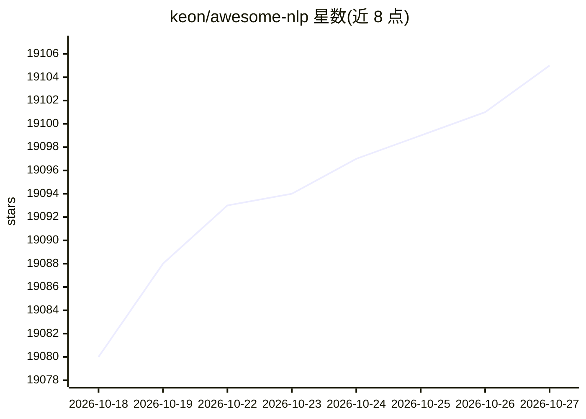

# keon/awesome-nlp

⭐ 19,105 · CC0-1.0 · 推送 2026-10-12 · [GitHub](https://github.com/keon/awesome-nlp) · 个人维护

**面向 NLP 学习者与研究者精选资源清单**

一个以自然语言处理为主题的 curated 资源清单，收录研究动态跟踪源、著名 NLP 实验室、教程/课程、书籍以及多语言 NLP 库链接。README 声明其范围限定于语言分析、多语言工具、经典与神经方法、数据集和评测；大语言模型仅在推进或评测核心 NLP 任务时收录，通用聊天机器人、agent 框架等被排除并指向其他清单。通过社区 pull request 持续维护，条目含 archived 标注。

## 筛选速览

| 维度 | 判定 | 备注 |
|---|---|---|
| AI 角色 | `ai-knowledge` | 知识聚合/清单类 |
| 许可风险 | `viral` | CC0-1.0 |
| 部署形态 | `None` |  |
| 模型依赖 | — | README 未给出锁定关系 |
| 硬件要求 | — | 无带数字的原话,不猜 |
| 安装摩擦 | `low` | 无编译、无系统依赖或容器化 |
| 成熟度 | — | 结构信号不足 |

## 动量与使用信号

- 维护:`active` — 距上次 push 5.4 天,年发版 0,146 位贡献者
- 涨星:近 1 天 **+2**(自 20261016 起算)

## 能力要点

- 按研究动态、实验室、教程、课程、书籍、库等栏目组织的资源链接
- README 明确界定收录范围：LLM 仅限推进核心 NLP 任务的场景
- 覆盖 Node.js/JavaScript 与 Python 等语言的 NLP 库条目
- 部分条目标注 archived 状态

## 适用场景

- 系统学习 NLP 时查找课程、书籍与教程
- 为项目挑选合适的 NLP 库或标注工具
- 跟踪 NLP 研究进展与论文来源

## 场景标签

`精选清单` · 领域:学习与行业

## 证据(README 行号)

> L5: A curated list of resources dedicated to Natural Language Processing
> L11: This list covers natural language processing — linguistic analysis, multilingual tooling, classical and neural meth

## 星数曲线

2026-10-18 19,080 → 2026-10-27 19,105（+25）

---
*卡片 v1 · prompt 1.4 · 生成 2026-10-18 · 置信度 high · 依据 README sha `71c4923881af` · [字段定义](../../DATASET.md)*
