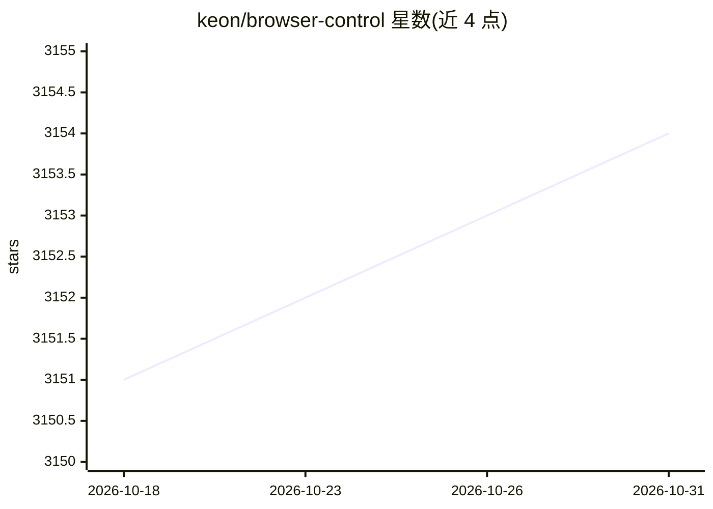

# keon/browser-control

⭐ 3,154 · Rust · MIT · 推送 2026-08-27 · [GitHub](https://github.com/keon/browser-control) · 个人维护

**Rust 编写的浏览器控制 CLI，供 coding agent 通过 CDP 驱动真实浏览器**

单二进制 Rust CLI，通过 Chrome DevTools Protocol 驱动本地或云端浏览器：提供页面快照、稳定的 @e1 式元素引用、原始 CDP 转发、隐藏事件守护进程与失败 trace 记录，命令输出紧凑文本或 JSON，供有 shell 能力的 coding agent 管道调用。本身不含 LLM、不依赖 MCP 或框架，规划与重试逻辑留在 agent 侧。支持 Browser Use、Steel、Hyperbrowser、Browserbase 等云浏览器预设及任意 CDP 端点。

## 筛选速览

| 维度 | 判定 | 备注 |
|---|---|---|
| AI 角色 | `ai-ecosystem` | LLM/agent 周边工具 |
| 许可风险 | `permissive` | MIT |
| 部署形态 | `library` | 以包/库形式分发 |
| 模型依赖 | — | README 未给出锁定关系 |
| 硬件要求 | — | 无带数字的原话,不猜 |
| 安装摩擦 | `low` | 无编译、无系统依赖或容器化 |
| 成熟度 | — | 结构信号不足 |

## 能力要点

- snapshot 产出稳定 @e1 引用，供 LLM 直接点击操作，兼容 CSS 选择器与坐标
- 隐藏守护进程记录事件/网络/控制台环形历史，命令失败写入 .browser-control/traces/
- 同一命令集驱动本地 Chrome 或云端会话（4 个内置预设 + 任意 CDP 提供商覆盖）
- init 附带交互与领域 skill 文档供 agent 按需阅读

## 适用场景

- 让 coding agent 在真实浏览器中执行网页操作并自我诊断失败
- 用 shell 管道组合浏览器命令做自动化，无需 SDK 或常驻服务
- 在云端浏览器会话上复用同一套本地调试命令

## 场景标签

`浏览器自动化` · 领域:效率与自动化

## 证据(README 行号)

> L7:  No LLM. No MCP requirement. No framework. Just compact, composable browser commands you can pipe from a shell.
> L204: `browser-control` is intentionally small: a shell-native Rust CLI around CDP, designed for coding agents that alre

## 星数曲线

2026-10-18 3,151 → 2026-10-31 3,154（+3）

---
*卡片 v1 · prompt 1.4 · 生成 2026-10-20 · 置信度 high · 依据 README sha `8275872c2abe` · [字段定义](../../DATASET.md)*
