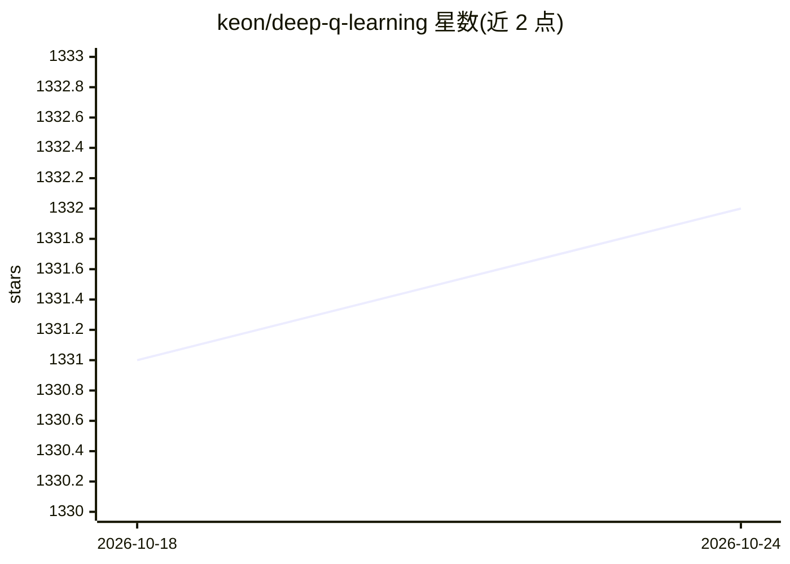

# keon/deep-q-learning

⭐ 1,332 · Python · MIT · 推送 2026-05-18 · [GitHub](https://github.com/keon/deep-q-learning) · [官网](https://keon.kim/writing/deep-q-learning/) · 个人维护

**Keras 实现的极简 DQN/DDQN 深度强化学习示例代码**

提供 DQN 与 Double DQN 的最小化参考实现，代码量控制在 100 行以内，基于 Keras（已更新至 Keras 3）与 Gymnasium 环境运行，默认环境为 CartPole。记忆采用 deque 限制容量，提供 save/load 函数持久化权重与 epsilon；ddqn.py 实现 online 网络选择动作、target 网络评估的 Double DQN 结构，并移除 CartPole 专属 reward shaping 使其环境无关。配套博客文章讲解代码。

## 筛选速览

| 维度 | 判定 | 备注 |
|---|---|---|
| AI 角色 | `ai-native` | 本体是模型或模型工具 |
| 许可风险 | `permissive` | MIT |
| 部署形态 | `None` |  |
| 模型依赖 | — | README 未给出锁定关系 |
| 硬件要求 | — | 无带数字的原话,不猜 |
| 安装摩擦 | `low` | 无编译、无系统依赖或容器化 |
| 成熟度 | — | 结构信号不足 |

## 能力要点

- DQN 与 Double DQN 双实现，主体代码少于 100 行
- 已迁移至 Gymnasium 与 Keras 3（Huber loss、Adam(learning_rate=)）
- ddqn.py 实现真正的 Double DQN（online 选择、target 评估）且环境无关
- save/load 持久化权重与 epsilon，memory 用 deque 限容

## 适用场景

- 学习 DQN/DDQN 的最小可运行实现
- 作为深度强化学习入门教学参考（配套博客讲解）
- 在 CartPole 等 Gymnasium 环境上快速验证算法行为

## 场景标签

`强化学习` `教程课程` · 领域:学习与行业

## 证据(README 行号)

> L7: Minimal and Simple Deep Q Learning Implemenation in Keras and Gym. Under 100 lines of code!
> L17: The training might be unstable for `dqn.py`. This problem is mitigated in `ddqn.py`.

## 星数曲线

2026-10-18 1,331 → 2026-10-24 1,332（+1）

---
*卡片 v1 · prompt 1.4 · 生成 2026-10-21 · 置信度 high · 依据 README sha `dd07a4b648fe` · [字段定义](../../DATASET.md)*
