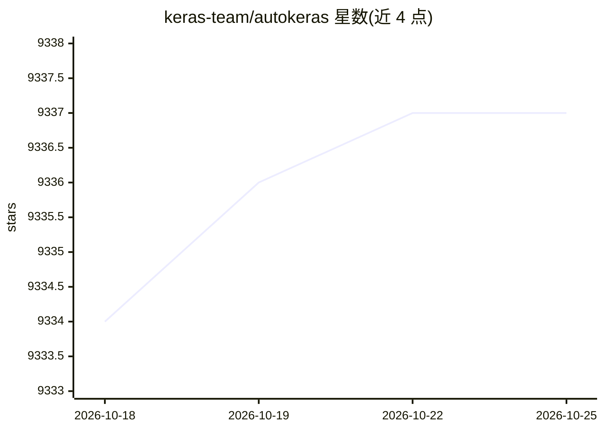

# keras-team/autokeras

⭐ 9,338 · Python · Apache-2.0 · 推送 2025-11-25 · [GitHub](https://github.com/keras-team/autokeras) · [官网](http://autokeras.com/) · 组织维护

**基于 Keras 的深度学习 AutoML 库，自动搜索模型结构**

AutoKeras 是 DATA Lab（德州农工大学）开发的 AutoML 库，基于 Keras/TensorFlow，通过自动神经架构搜索等机制，让用户以少量代码（如 ImageClassifier 三行完成训练与预测）获得图像分类、回归等任务的深度学习模型。要求 Python >= 3.7、TensorFlow >= 2.8.0，pip 安装。配套教程、书籍与 JMLR 论文，曾受 DARPA D3M 项目资助。

## 筛选速览

| 维度 | 判定 | 备注 |
|---|---|---|
| AI 角色 | `ai-native` | 本体是模型或模型工具 |
| 许可风险 | `permissive` | Apache-2.0 |
| 部署形态 | `library` | 以包/库形式分发 |
| 模型依赖 | — | README 未给出锁定关系 |
| 硬件要求 | — | 无带数字的原话,不猜 |
| 安装摩擦 | `low` | 无编译、无系统依赖或容器化 |
| 成熟度 | — | 结构信号不足 |

## 能力要点

- 自动化的图像分类等任务的模型搜索与训练
- 少量代码即可完成 fit/predict 流程
- 基于 Keras/TensorFlow 生态构建

## 适用场景

- 不想手工调模型结构，自动搜索合适的深度学习模型
- 快速搭建图像分类等任务的基线模型
- 机器学习入门者用少量代码完成建模

## 场景标签

 · 领域:机器学习/AutoML

## 证据(README 行号)

> L10: AutoKeras: An AutoML system based on Keras.
> L21: clf = ak.ImageClassifier()
> L45: **Note:** Currently, AutoKeras is only compatible with **Python >= 3.7** and **TensorFlow >= 2.8.0**.

## 星数曲线

2026-10-18 9,334 → 2026-10-25 9,337（+3）

---
*卡片 v1 · prompt 1.4 · 生成 2026-10-20 · 置信度 high · 依据 README sha `d1d10820a0bb` · [字段定义](../../DATASET.md)*
