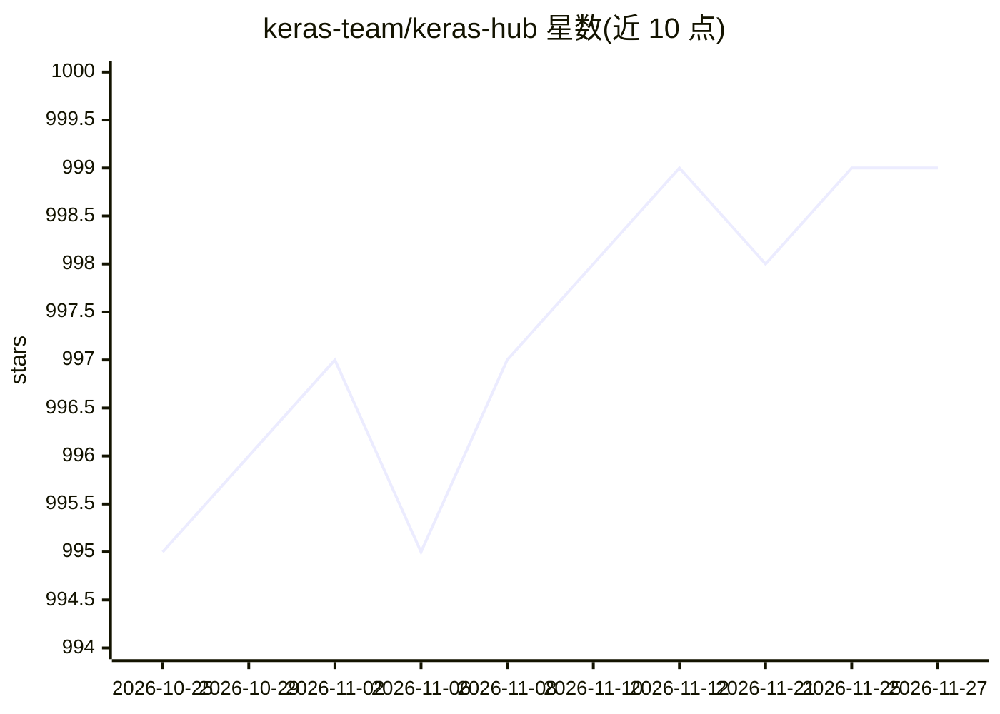

# keras-team/keras-hub

⭐ 999 · Python · Apache-2.0 · 推送 2026-11-26 · [GitHub](https://github.com/keras-team/keras-hub) · [官网](https://keras.io/keras_hub/) · 组织维护

**Keras 3 预训练模型库：文本/图像/音频任务的加载与微调**

KerasHub 是 Keras 3 的预训练建模扩展库，以 Layer/Model 形式提供流行模型架构实现，并配套 Kaggle Models 上的预训练权重。同一模型定义支持 JAX、TensorFlow、PyTorch 三种后端，内置 PEFT 技术与模型/数据并行训练，可在 GPU 和 TPU 上微调。通过 from_preset API 加载 ResNet、BERT 等模型执行生成、分类等任务。安装即拉取 TensorFlow 用于 tf.data 预处理；0.y.z 阶段 API 可能破坏性变更；所含第三方模型遵循各自独立许可。

## 筛选速览

| 维度 | 判定 | 备注 |
|---|---|---|
| AI 角色 | `ai-native` | 本体是模型或模型工具 |
| 许可风险 | `permissive` | Apache-2.0 |
| 部署形态 | `library` | 以包/库形式分发 |
| 模型依赖 | — | README 未给出锁定关系 |
| 硬件要求 | — | 无带数字的原话,不猜 |
| 安装摩擦 | `low` | 无编译、无系统依赖或容器化 |
| 成熟度 | — | 结构信号不足 |

## 能力要点

- Keras 3 实现的流行模型架构 + Kaggle Models 预训练权重
- 单一模型定义同时支持 JAX、TensorFlow、PyTorch 三后端
- 内置 PEFT 技术与模型/数据并行训练，支持 GPU/TPU 微调
- from_preset API 直接加载模型用于生成、分类等任务

## 适用场景

- 加载预训练 ResNet 对图像做分类预测
- 用 BERT 在 IMDb 评论上微调文本分类器
- 在不同计算后端之间切换同一模型代码
- 对文本/图像/音频数据执行生成或分类任务

## 场景标签

`微调` · 领域:训练与推理

## 证据(README 行号)

> L15: Models can be used with text, image, and audio data for generation, classification,
> L22: All models support JAX, TensorFlow, and PyTorch from a single model

## 星数曲线

2026-10-25 995 → 2026-11-27 999（+4）

---
*卡片 v1 · prompt 1.4 · 生成 2026-11-24 · 置信度 high · 依据 README sha `d4d7a7b88d7d` · [字段定义](../../DATASET.md)*
