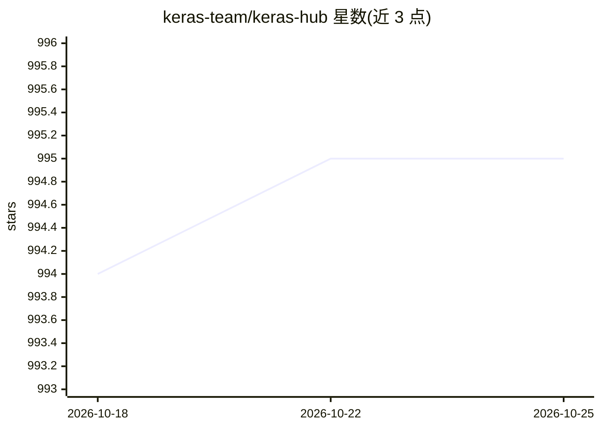

# keras-team/keras-hub

⭐ 995 · Python · Apache-2.0 · 推送 2026-10-20 · [GitHub](https://github.com/keras-team/keras-hub) · [官网](https://keras.io/keras_hub/) · 组织维护

**Keras 3 多框架预训练模型库：文本/图像/音频开箱即用**

Keras 3 的预训练建模库，提供主流模型架构的 Keras 实现及 Kaggle Models 上的预训练权重，覆盖文本、图像、音频的生成与分类等任务。同一模型定义可在 JAX、TensorFlow、PyTorch 三种后端运行，支持 GPU/TPU 微调、内置 PEFT 技术及模型与数据并行训练。组件以 Keras Layer/Model 形式提供；安装会拉取 TensorFlow 用于 tf.data 预处理。当前为 0.y.z 预发布阶段，API 可能不保证稳定。

## 筛选速览

| 维度 | 判定 | 备注 |
|---|---|---|
| AI 角色 | `ai-native` | 本体是模型或模型工具 |
| 许可风险 | `permissive` | Apache-2.0 |
| 部署形态 | `library` | 以包/库形式分发 |
| 模型依赖 | — | README 未给出锁定关系 |
| 硬件要求 | — | 无带数字的原话,不猜 |
| 安装摩擦 | `low` | 无编译、无系统依赖或容器化 |
| 成熟度 | `idea` | |

## 能力要点

- 同一模型定义支持 JAX / TensorFlow / PyTorch 三种后端
- 提供 Kaggle Models 上的预训练权重，覆盖文本/图像/音频任务
- 内置 PEFT 微调技术与模型/数据并行训练
- 组件以 Keras Layer/Model 形式提供，兼容 Keras API 习惯

## 适用场景

- 加载 BERT、ResNet 等预训练模型做分类或生成
- 在 GPU/TPU 上微调模型（含 PEFT 与并行训练）
- 在同一套代码下切换 JAX/TensorFlow/PyTorch 后端

## 场景标签

`微调` · 领域:训练与推理

## 证据(README 行号)

> L11: **KerasHub** is a pretrained modeling library that aims to be simple, flexible,
> L15: Models can be used with text, image, and audio data for generation, classification,
> L22: All models support JAX, TensorFlow, and PyTorch from a single model

## 星数曲线

2026-10-18 994 → 2026-10-25 995（+1）

---
*卡片 v1 · prompt 1.4 · 生成 2026-10-21 · 置信度 high · 依据 README sha `493740fbd366` · [字段定义](../../DATASET.md)*
