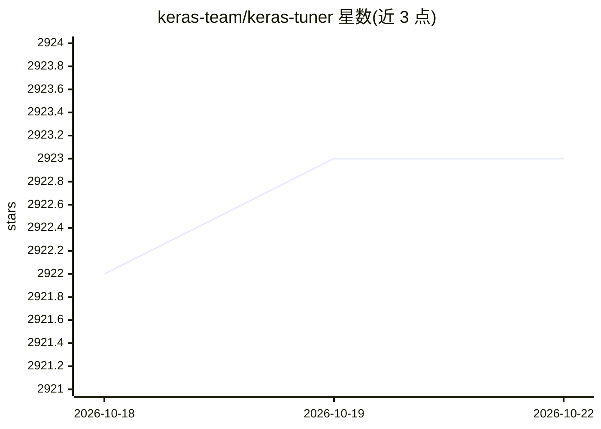

# keras-team/keras-tuner

⭐ 2,923 · Python · Apache-2.0 · 推送 2025-12-01 · [GitHub](https://github.com/keras-team/keras-tuner) · [官网](https://keras.io/keras_tuner/) · 组织维护

**Keras 超参数调优库：自动搜索模型最佳超参数**

面向 Keras/TensorFlow 用户的超参数优化框架：以 define-by-run 语法定义搜索空间，内置贝叶斯优化、Hyperband 与随机搜索三种算法，通过指定 objective 与 max_trials 运行搜索并返回最优模型；同时设计为可供研究者扩展实现新搜索算法。以 Python 库形式发布，要求 Python 3.8+ 与 TensorFlow 2.0+。由 keras-team 维护，附官方文档站点与 BibTeX 引用条目。

## 筛选速览

| 维度 | 判定 | 备注 |
|---|---|---|
| AI 角色 | `ai-ecosystem` | LLM/agent 周边工具 |
| 许可风险 | `permissive` | Apache-2.0 |
| 部署形态 | `library` | 以包/库形式分发 |
| 模型依赖 | — | README 未给出锁定关系 |
| 硬件要求 | — | 无带数字的原话,不猜 |
| 安装摩擦 | `low` | 无编译、无系统依赖或容器化 |
| 成熟度 | — | 结构信号不足 |

## 能力要点

- 内置贝叶斯优化、Hyperband、随机搜索三种算法
- define-by-run 语法定义搜索空间
- 面向研究者可扩展新搜索算法

## 适用场景

- 为 Keras 模型自动搜索最优超参数
- 对比多种调参算法的搜索结果
- 研究并实现自定义超参数搜索算法

## 场景标签

`MLOps` · 领域:训练与推理

## 证据(README 行号)

> L6: KerasTuner is an easy-to-use, scalable hyperparameter optimization framework
> L10: KerasTuner comes with Bayesian Optimization, Hyperband, and Random Search algorithms

## 星数曲线

2026-10-18 2,922 → 2026-10-22 2,923（+1）

---
*卡片 v1 · prompt 1.4 · 生成 2026-10-21 · 置信度 high · 依据 README sha `6250dc1d5cf3` · [字段定义](../../DATASET.md)*
