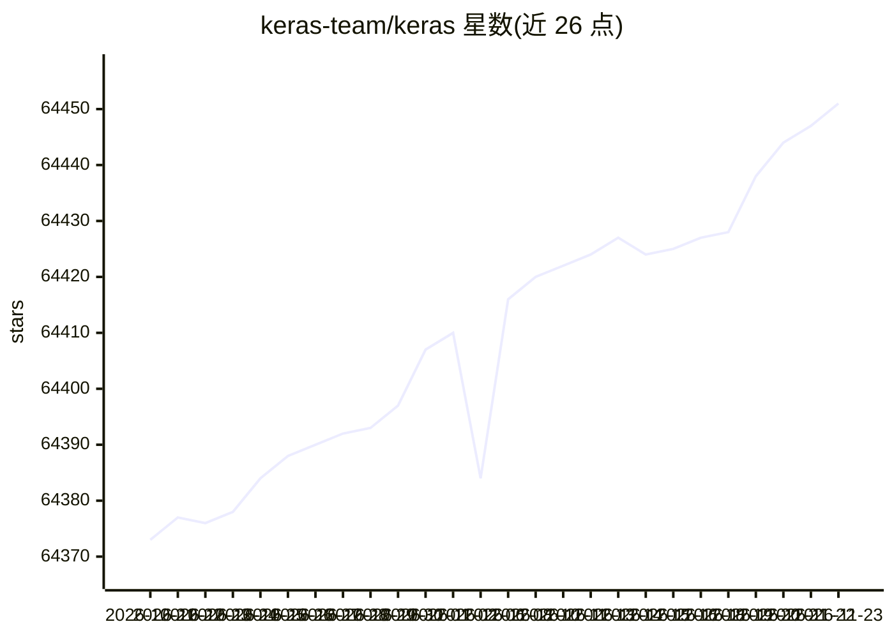

# keras-team/keras

⭐ 64,451 · Python · Apache-2.0 · 推送 2026-11-20 · [GitHub](https://github.com/keras-team/keras) · [官网](http://keras.io/) · 组织维护

**面向深度学习开发者的多后端高层框架**

Keras 3 是多后端深度学习框架，支持 JAX、TensorFlow、PyTorch 及 OpenVINO（仅推理），通过 `KERAS_BACKEND` 环境变量或配置文件切换后端，导入后不可更改。覆盖计算机视觉、NLP、音频、时间序列预测、推荐系统等任务的模型构建与训练，可从笔记本扩展到 GPU/TPU 集群。提供 PyPI 包及本地源码安装，支持 `.keras` 格式保存，作为 `tf.keras` 的直接替代使用。

## 筛选速览

| 维度 | 判定 | 备注 |
|---|---|---|
| AI 角色 | `ai-native` | 本体是模型或模型工具 |
| 许可风险 | `permissive` | Apache-2.0 |
| 部署形态 | `library` | 以包/库形式分发 |
| 模型依赖 | local-ok | 支持本地模型 |
| 硬件要求 | `cpu-ok` | |
| 安装摩擦 | `medium` | 含编译或系统依赖之一 |
| 成熟度 | — | 结构信号不足 |

## 动量与使用信号

- 维护:`active` — 距上次 push 1.4 天,年发版 12,408 位贡献者
- 涨星:近 1 天 **+2**(自 20261016 起算)
- 安装:pypi 包 `keras` 月下载 11,386,830
- 平台:WINDOWS / MACOS / LINUX · 协议:—

## 能力要点

- 多后端支持：JAX/TensorFlow/PyTorch/OpenVINO，可配置切换
- 兼容 tf.keras 代码，模型可在不同后端上运行
- 提供各后端的 CUDA 版依赖文件（requirements-{backend}-cuda.txt）
- Keras 组件可在 TF/JAX/PyTorch 原生工作流中复用

## 适用场景

- 用统一高层 API 构建和训练视觉/NLP/时序模型
- 在多个框架后端之间切换以避免锁定
- 将现有 tf.keras 代码迁移到 JAX/PyTorch 后端运行

## 场景标签

`模型训练` · 领域:训练与推理

## 证据(README 行号)

> L3: Keras 3 is a multi-backend deep learning framework, with support for JAX, TensorFlow, PyTorch, and OpenVINO (for inf
> L9: - **State-of-the-art performance**: By picking the backend that is the fastest for your model architecture (often JA
> L92: You can export the environment variable `KERAS_BACKEND` or you can edit your local config file at `~/.keras/keras.j

## 星数曲线

2026-10-21 64,373 → 2026-11-23 64,451（+78）

---
*卡片 v1 · prompt 1.4 · 生成 2026-11-22 · 置信度 high · 依据 README sha `425fe08e7e57` · [字段定义](../../DATASET.md)*
