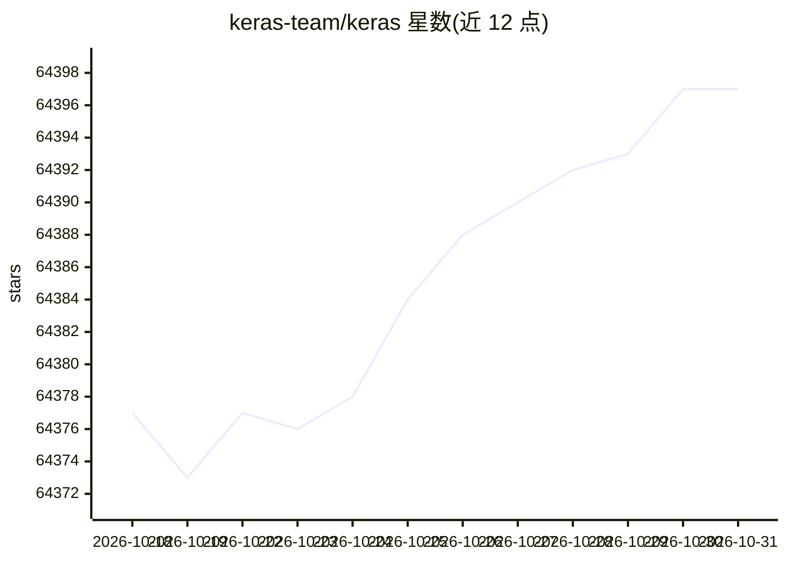

# keras-team/keras

⭐ 64,397 · Python · Apache-2.0 · 推送 2026-10-30 · [GitHub](https://github.com/keras-team/keras) · [官网](http://keras.io/) · 组织维护

**给深度学习开发者用的多后端神经网络框架**

Keras 3 是多后端深度学习框架，可在 JAX、TensorFlow、PyTorch 之上运行，另提供仅推理的 OpenVINO 后端；通过环境变量 KERAS_BACKEND 或配置文件切换后端，导入后不可更改。覆盖计算机视觉、自然语言处理、音频、时序、推荐等任务，可作为 tf.keras 的替代（drop-in replacement），Keras 模型可用 tf.data.Dataset 或 PyTorch DataLoader 数据集训练。Linux/macOS 直接安装，Windows 建议 WSL2。

## 筛选速览

| 维度 | 判定 | 备注 |
|---|---|---|
| AI 角色 | `ai-ecosystem` | LLM/agent 周边工具 |
| 许可风险 | `permissive` | Apache-2.0 |
| 部署形态 | `library` | 以包/库形式分发 |
| 模型依赖 | local-ok | 支持本地模型 |
| 硬件要求 | `cpu-ok` | |
| 安装摩擦 | `medium` | 含编译或系统依赖之一 |
| 成熟度 | — | 结构信号不足 |

## 动量与使用信号

- 维护:`active` — 距上次 push 1.4 天,年发版 12,408 位贡献者
- 涨星:近 1 天 **+2**(自 20261016 起算)
- 安装:pypi 包 `keras` 月下载 11,386,830
- 平台:WINDOWS / MACOS / LINUX · 协议:—

## 能力要点

- 多后端支持：JAX、TensorFlow、PyTorch、OpenVINO（仅推理）
- 通过 KERAS_BACKEND 环境变量或 ~/.keras/keras.json 配置后端
- 作为 tf.keras 的 drop-in replacement，支持迁移现有代码
- 提供各后端 CUDA 依赖的 requirements 文件

## 适用场景

- 在多个底层框架上运行同一套高层建模工作流
- 将现有 tf.keras 代码迁移到 JAX 或 PyTorch 后端
- 编写跨框架可用的自定义层、模型与指标
- 从笔记本扩展到 GPU/TPU 集群进行大规模训练

## 场景标签

`模型训练` · 领域:训练与推理

## 证据(README 行号)

> L3: Keras 3 is a multi-backend deep learning framework, with support for JAX, TensorFlow, PyTorch, and OpenVINO (for inf
> L84: You can export the environment variable `KERAS_BACKEND` or you can edit your local config file at `~/.keras/keras.j

## 星数曲线

2026-10-18 64,377 → 2026-10-31 64,397（+20）

---
*卡片 v1 · prompt 1.4 · 生成 2026-10-18 · 置信度 high · 依据 README sha `47cfd8c8f6e3` · [字段定义](../../DATASET.md)*
