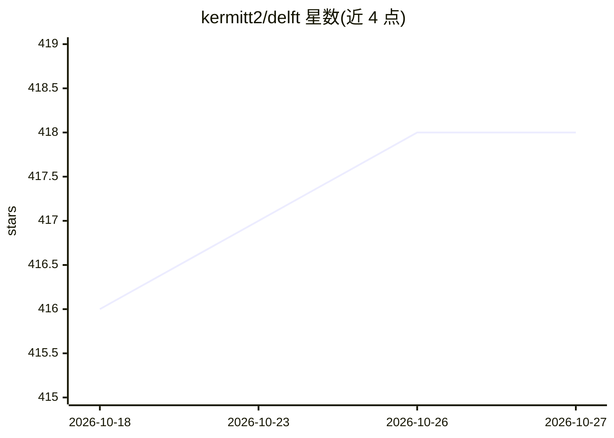

# kermitt2/delft

⭐ 418 · Python · Apache-2.0 · 推送 2026-10-23 · [GitHub](https://github.com/kermitt2/delft) · 个人维护

**面向文本的深度学习框架：序列标注与文本分类**

基于 Keras/TensorFlow 的文本处理框架，聚焦序列标注（如命名实体识别、信息抽取）与文本分类（如评论分类），复现多种 RNN 与 transformer 架构，统一 API 与输入格式。支持富文本（含版面/位置等上下文特征）、动态数据生成器、海量静态词向量加载、n-fold 交叉验证评测，并将 HuggingFace transformers 集成为 Keras 层。RNN 模型经压缩后普遍小于 2MB，可供 GROBID 经 JEP 进行 Java 集成。0.4.x 需 Python 3.10+、TensorFlow 2.17，GPU 需 CUDA 12.1；ELMo 已移除。

## 筛选速览

| 维度 | 判定 | 备注 |
|---|---|---|
| AI 角色 | `ai-native` | 本体是模型或模型工具 |
| 许可风险 | `permissive` | Apache-2.0 |
| 部署形态 | `library` | 以包/库形式分发 |
| 模型依赖 | — | README 未给出锁定关系 |
| 硬件要求 | — | 无带数字的原话,不猜 |
| 安装摩擦 | `medium` | 含编译或系统依赖之一 |
| 成熟度 | — | 结构信号不足 |

## 能力要点

- 统一 API 下实现 RNN 与 transformer 多种 NLP 架构
- 支持带版面与位置特征的富文本输入
- 模型体积压缩：除 Ontonotes NER 外均小于 2MB
- 集成 HuggingFace transformers 为 Keras 层，支持多 GPU 训练与推理

## 适用场景

- 训练命名实体识别模型做文献信息抽取
- 复现与基准对比序列标注/文本分类方法
- 在小显存 GPU（如 4GB）上训练 BERT base 级模型
- 经 JEP 嵌入 Java 应用（如 GROBID）使用 NLP 模型

## 场景标签

 · 领域:NLP/深度学习

## 证据(README 行号)

> L10: __DeLFT__ (**De**ep **L**earning **F**ramework for **T**ext) is a Keras and TensorFlow framework for text processin
> L38: The DeLFT __0.4.x__ release line has been tested successfully with Python 3.10/3.11 and TensorFlow 2.17 (see the Py

## 星数曲线

2026-10-18 416 → 2026-10-27 418（+2）

---
*卡片 v1 · prompt 1.4 · 生成 2026-10-21 · 置信度 high · 依据 README sha `0ef8992e3cb0` · [字段定义](../../DATASET.md)*
