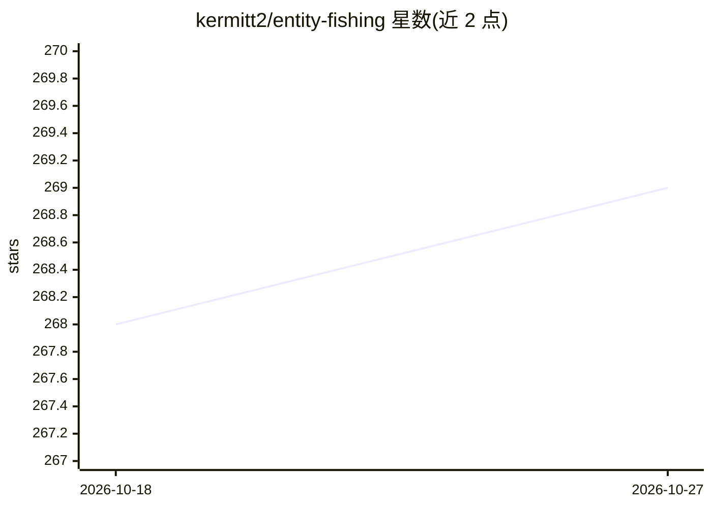

# kermitt2/entity-fishing

⭐ 269 · Java · Apache-2.0 · 推送 2026-08-05 · [GitHub](https://github.com/kermitt2/entity-fishing) · [官网](http://nerd.readthedocs.io/) · 个人维护

**面向 15 种语言的实体识别与消歧工具（基于 Wikidata）**

entity-fishing 是基于机器学习的实体识别与消歧服务：对原始文本、部分标注文本、PDF 文档（含版面定位）进行实体识别，并对照 Wikidata（约 9600 万实体）消歧；另支持搜索短文本消歧、加权词向量消歧与实验性的编辑器实时消歧。覆盖 15 种语言，内置 NER 仅限英语与法语；提供查询 DSL、公开演示服务器与 Docker 镜像自部署。自述为进行中的副项目（v0.0.6），F1 在 76.5-89.1 区间，运行需 3-4GB 内存与 SSD。

## 筛选速览

| 维度 | 判定 | 备注 |
|---|---|---|
| AI 角色 | `ai-native` | 本体是模型或模型工具 |
| 许可风险 | `permissive` | Apache-2.0 |
| 部署形态 | `None` |  |
| 模型依赖 | — | README 未给出锁定关系 |
| 硬件要求 | — | 无带数字的原话,不猜 |
| 安装摩擦 | `low` | 无编译、无系统依赖或容器化 |
| 成熟度 | `idea` | |

## 能力要点

- 对 15 种语言做实体识别与 Wikidata 消歧（文本/短文本/PDF）
- 知识库含约 9600 万 Wikidata 实体，可用 GRISP 生成自建知识库
- 提供查询 DSL、公开演示服务器与 Docker 自部署镜像
- 单机可达每秒数千 token 的处理速度（README 给出基准数据）

## 适用场景

- 学术文献与 PDF 的规模化实体识别与链接
- 搜索引擎查询的短文本消歧
- 数字人文平台中批量处理全文文档的实体标注

## 场景标签

`知识图谱` · 领域:知识与检索

## 证据(README 行号)

> L11: * general entity recognition and disambiguation against Wikidata in a raw text or partially-annotated text segment,
> L48: Evaluations above correspond to the "overall unnormalized accuracy" scenario in BLINK and are limited to Named Enti

## 星数曲线

2026-10-18 268 → 2026-10-27 269（+1）

---
*卡片 v1 · prompt 1.4 · 生成 2026-10-22 · 置信度 high · 依据 README sha `b2527f8720d3` · [字段定义](../../DATASET.md)*
