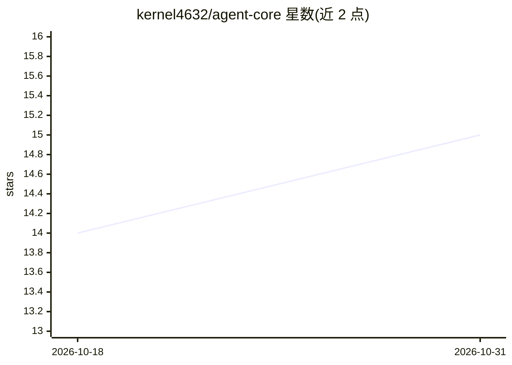

# kernel4632/agent-core

⭐ 15 · JavaScript · MIT · 推送 2026-10-16 · [GitHub](https://github.com/kernel4632/agent-core) · 个人维护 · 中文 README

**面向开发者的轻量 AI Agent 循环核心库（Bun）**

一个 npm 包形式的 Agent 核心引擎：开发者提供模型服务地址（baseURL/model）和工具（工具文件目录或内存工具对象），包自动执行「问模型→执行工具→再问模型」循环直至任务完成。关键机制包括：history 只增不删、上下文压缩不丢原文只追加总结且总结折进 system、同轮工具并行且每个工具在独立子进程运行、支持 4 种协议（chat/responses/anthropic/gemini）、纯对话模型可通过 text 模式模拟工具调用、MCP 与技能由应用侧接入后汇入工具。限制：需要 Bun 运行时，不支持 Node.js；MCP 连接与技能读取不在包职责内。

## 筛选速览

| 维度 | 判定 | 备注 |
|---|---|---|
| AI 角色 | `ai-ecosystem` | LLM/agent 周边工具 |
| 许可风险 | `permissive` | MIT |
| 部署形态 | `None` |  |
| 模型依赖 | — | README 未给出锁定关系 |
| 硬件要求 | — | 无带数字的原话,不猜 |
| 安装摩擦 | `low` | 无编译、无系统依赖或容器化 |
| 成熟度 | — | 结构信号不足 |

## 能力要点

- 4 种协议支持：chat / responses / anthropic / gemini
- 工具在独立子进程执行，同轮工具并行、崩溃隔离
- 上下文压缩保留：history 永不删、总结折进 system、按回合裁剪
- toolMode=text/auto 让纯对话模型也能用工具

## 适用场景

- 在自己的应用中嵌入模型-工具循环，只需写工具文件
- 长会话 Agent 保留完整 history 并自动压缩上下文
- 将 MCP 工具与 SKILL.md 技能汇入统一的工具注册体系

## 场景标签

`Agent 框架` · 领域:Agent 开发

## 证据(README 行号)

> L6: 一个轻量的 AI Agent 核心包。给它一个 LLM 地址和一些工具（工具文件目录，或内存里的工具对象），它就能自动循环"问模型 → 执行工具 → 再问模型"，直到任务完成。
> L75: 这个包需要 Bun 运行时（不支持 Node.js）。

## 星数曲线

2026-10-18 14 → 2026-10-31 15（+1）

---
*卡片 v1 · prompt 1.4 · 生成 2026-10-31 · 置信度 high · 依据 README sha `31c43020c17e` · [字段定义](../../DATASET.md)*
