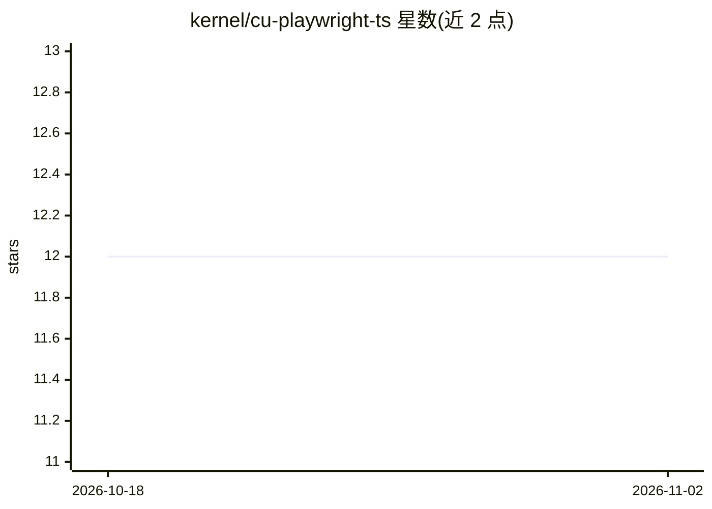

# kernel/cu-playwright-ts

⭐ 12 · TypeScript · MIT · 推送 2026-10-22 · [GitHub](https://github.com/kernel/cu-playwright-ts) · 组织维护

**把 Claude Computer Use 映射到 Playwright 的浏览器自动化 TypeScript SDK**

TypeScript SDK，将 Anthropic 的 Computer Use 能力与 Playwright 结合：通过单个 ComputerUseAgent 类，开发者传入任务描述（query），SDK 调用 Claude 模型驱动 Playwright 页面完成浏览器交互。支持文本与 Zod 校验的结构化 JSON 两种响应，可配置模型（默认 claude-sonnet-4-20250514）与 thinkingBudget 推理 token 预算，内置错误处理。需要 Anthropic API key、Node.js 18+、TypeScript 5+、Playwright 1.52+。面向构建浏览器自动化 agent 的开发者。

## 筛选速览

| 维度 | 判定 | 备注 |
|---|---|---|
| AI 角色 | `ai-ecosystem` | LLM/agent 周边工具 |
| 许可风险 | `permissive` | MIT |
| 部署形态 | `library` | 以包/库形式分发 |
| 模型依赖 | locked-api |  |
| 硬件要求 | — | 无带数字的原话,不猜 |
| 安装摩擦 | `low` | 无编译、无系统依赖或容器化 |
| 成熟度 | — | 结构信号不足 |

## 能力要点

- 单 ComputerUseAgent 类封装 Claude Computer Use 到 Playwright 的映射
- Zod schema 校验的结构化 JSON 响应
- thinkingBudget 可调节 Claude 推理 token 预算（默认 1024）

## 适用场景

- 用自然语言指令驱动 Playwright 完成浏览器操作
- 从网页任务中提取结构化数据（JSON schema 校验）
- 构建浏览器自动化 agent 的底层执行层

## 场景标签

`浏览器自动化` · 领域:效率与自动化

## 证据(README 行号)

> L3: A TypeScript SDK that combines Anthropic's Computer Use capabilities with Playwright for browser automation tasks. T
> L7: - 🤖 **Simple API**: Single `ComputerUseAgent` class for all computer use tasks

## 星数曲线

2026-10-18 12 → 2026-11-02 12（+0）

---
*卡片 v1 · prompt 1.4 · 生成 2026-11-01 · 置信度 high · 依据 README sha `678f19e07c22` · [字段定义](../../DATASET.md)*
