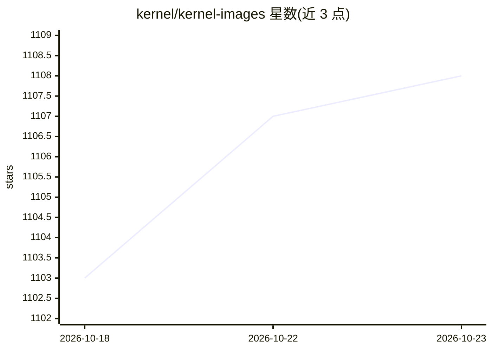

# kernel/kernel-images

⭐ 1,108 · Go · Apache-2.0 · 推送 2026-10-21 · [GitHub](https://github.com/kernel/kernel-images) · [官网](https://www.kernel.sh) · 组织维护

**面向自动化与 Web Agent 的沙箱化 Chrome 浏览器运行环境**

提供可在 Docker 容器或 Unikraft unikernel 上运行的有头 Chromium 镜像，通过 9222 端口暴露 Chrome DevTools Protocol，供 Playwright、Puppeteer 等框架远程连接驱动；内嵌 NoVNC/WebRTC 实时视图用于监控与远程控制，支持会话录像回放。unikernel 实现支持待机快照恢复与 <20ms 冷重启。面向构建浏览器自动化工作流和测试浏览器 AI Agent 的开发者；该仓库同时支撑其托管服务。限制：WebRTC 音频流目前不可用，unikernel 部署生成的 URL 公开可访问。

## 筛选速览

| 维度 | 判定 | 备注 |
|---|---|---|
| AI 角色 | `ai-ecosystem` | LLM/agent 周边工具 |
| 许可风险 | `permissive` | Apache-2.0 |
| 部署形态 | `self-host` | docker 或自建部署 |
| 模型依赖 | — | README 未给出锁定关系 |
| 硬件要求 | — | 无带数字的原话,不猜 |
| 安装摩擦 | `low` | 无编译、无系统依赖或容器化 |
| 成熟度 | — | 结构信号不足 |

## 能力要点

- 通过 CDP 端口接入 Playwright/Puppeteer 驱动云端浏览器
- unikernel 待机快照恢复与 <20ms 冷重启
- NoVNC/WebRTC 实时远程视图（可设只读）与会话录像
- 支持 Docker 容器与 Unikraft unikernel 两种运行方式

## 适用场景

- 运行自动化浏览器工作流
- 开发与测试需要操作浏览器的 AI agent
- 构建需要受控浏览器环境的自定义工具

## 场景标签

`浏览器自动化` · 领域:效率与自动化

## 证据(README 行号)

> L10: Kernel provides sandboxed, ready-to-use Chrome browsers for browser automations and web agents. This repo powers ou
> L24: - Develop and test AI agents that use browsers
> L88: Port `9222` is exposed via `ncat`, allowing you to connect Chrome DevTools Protocol-based browser frameworks like P

## 星数曲线

2026-10-18 1,103 → 2026-10-23 1,108（+5）

---
*卡片 v1 · prompt 1.4 · 生成 2026-10-21 · 置信度 high · 依据 README sha `0a2ad1edb913` · [字段定义](../../DATASET.md)*
