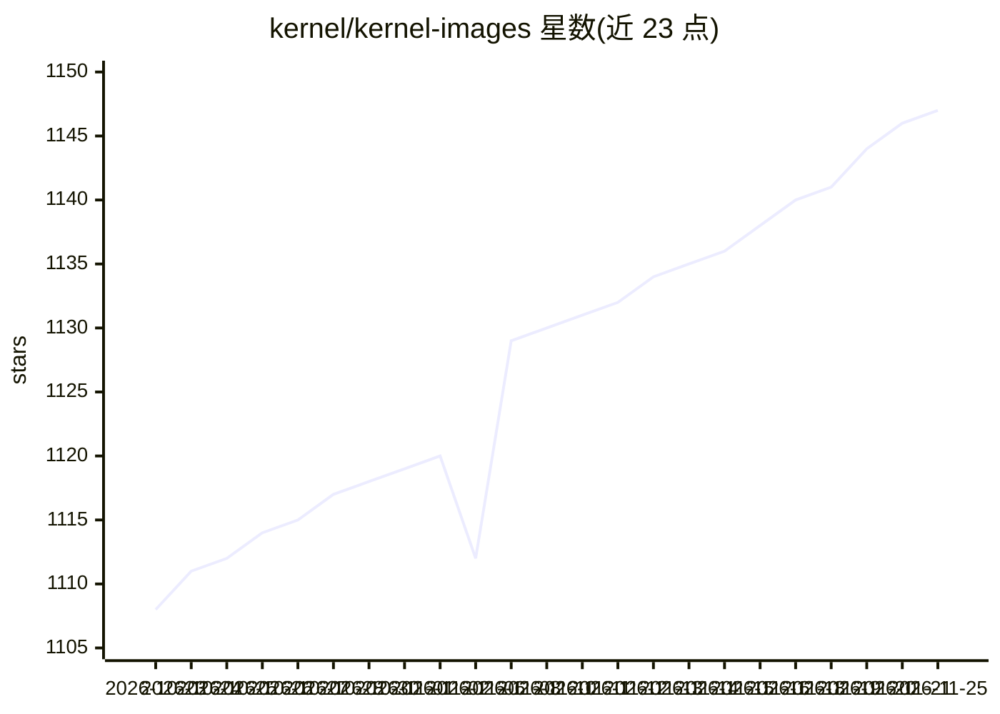

# kernel/kernel-images

⭐ 1,147 · Go · Apache-2.0 · 推送 2026-11-23 · [GitHub](https://github.com/kernel/kernel-images) · [官网](https://www.kernel.sh) · 组织维护

**为自动化与 web agent 提供沙箱化 Chrome 浏览器镜像**

Kernel 提供沙箱化的即用 Chrome 浏览器镜像，供浏览器自动化与 web agent 连接，本仓库是其托管服务背后的镜像实现。镜像可用 Docker 容器或 Unikraft unikernel 两种方式运行 headful Chromium；通过暴露的 9222 端口支持 Playwright、Puppeteer 等 CDP 框架远程驱动浏览器；内置 noVNC/WebRTC 实时查看与远程控制、会话录像捕获；unikernel 模式支持无活动时的待机休眠、状态快照恢复与 <20ms 冷重启。README 注明公开部署 URL 任何人可访问，仅适合非敏感操作。

## 筛选速览

| 维度 | 判定 | 备注 |
|---|---|---|
| AI 角色 | `ai-ecosystem` | LLM/agent 周边工具 |
| 许可风险 | `permissive` | Apache-2.0 |
| 部署形态 | `self-host` | docker 或自建部署 |
| 模型依赖 | — | README 未给出锁定关系 |
| 硬件要求 | — | 无带数字的原话,不猜 |
| 安装摩擦 | `low` | 无编译、无系统依赖或容器化 |
| 成熟度 | — | 结构信号不足 |

## 能力要点

- 沙箱化 Chrome，可被 Playwright/Puppeteer 等 CDP 框架通过 9222 端口连接
- Docker 与 Unikraft unikernel 两种运行方式，后者支持快照休眠与 <20ms 冷重启
- noVNC/WebRTC 内置实时查看，支持读写、窗口调整与只读模式
- 内置录像服务器，输出 H.264/MPEG-4 AVC 会话录像

## 适用场景

- 运行自动化浏览器工作流
- 开发测试使用浏览器的 AI agent
- 构建需要受控浏览器环境的自定义工具
- 远程监控与操控云端浏览器会话

## 场景标签

`浏览器自动化` · 领域:效率与自动化

## 证据(README 行号)

> L10: Kernel provides sandboxed, ready-to-use Chrome browsers for browser automations and web agents. This repo powers ou
> L24: - Develop and test AI agents that use browsers
> L88: Port `9222` is exposed via `ncat`, allowing you to connect Chrome DevTools Protocol-based browser frameworks like P

## 星数曲线

2026-10-23 1,108 → 2026-11-25 1,147（+39）

---
*卡片 v1 · prompt 1.4 · 生成 2026-11-24 · 置信度 high · 依据 README sha `2bbb655d8b10` · [字段定义](../../DATASET.md)*
