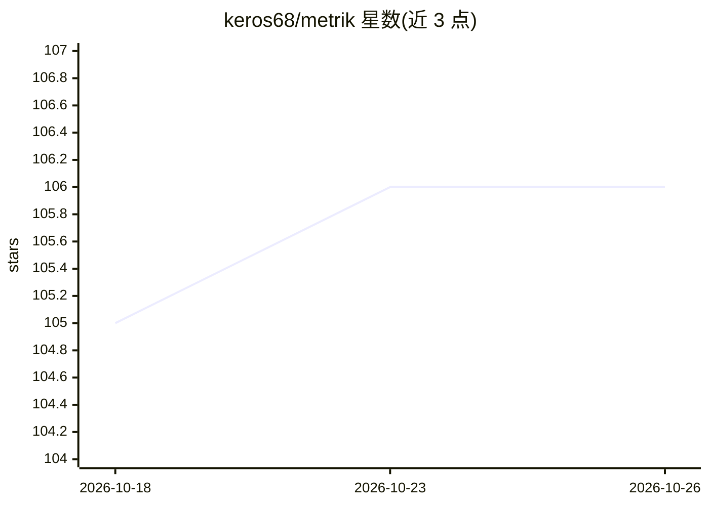

# keros68/metrik

⭐ 106 · Rust · AGPL-3.0 · 推送 2026-10-25 · [GitHub](https://github.com/keros68/metrik) · 个人维护 · 中文 README

**桌面组件：集中查看多个 AI 编程 Agent 的配额余量与 Token 用量**

基于 Tauri 2 的桌面应用，支持 Windows、macOS 与 Ubuntu 24.04 x86_64。通过解析本机日志（如 ~/.claude/projects、~/.codex/sessions）统计各 Agent 的 Token 用量，并调用各 Agent 官方配额接口读取剩余额度与重置时间，支持 15 种 Agent（ChatGPT/Codex、Claude、GLM、Kimi、OpenCode、Cursor 等）。提供配额卡片、桌面小组件/菜单栏面板、26 周热力图与 CSV 导出，支持经坚果云/OneDrive/Synthg 等共享文件夹做多设备同步。数据库不写入提示词、回复正文与凭据。

## 筛选速览

| 维度 | 判定 | 备注 |
|---|---|---|
| AI 角色 | `ai-ecosystem` | LLM/agent 周边工具 |
| 许可风险 | `viral` | AGPL-3.0 |
| 部署形态 | `desktop` | 安装包/桌面程序 |
| 模型依赖 | — | README 未给出锁定关系 |
| 硬件要求 | — | 无带数字的原话,不猜 |
| 安装摩擦 | `low` | 无编译、无系统依赖或容器化 |
| 成熟度 | — | 结构信号不足 |

## 能力要点

- 解析本机 Agent 日志统计 Token 用量，从官方接口读取配额余量与重置时间
- 支持 15 种 Agent：ChatGPT/Codex、Claude、GLM、Kimi、OpenCode、Antigravity、Cursor 等
- 26 周热力图、周趋势、Agent 占比与按项目会话明细，可导出 CSV
- 通过坚果云/OneDrive/Syncthing 共享文件夹同步多设备近 30 天统计

## 适用场景

- 同时用多个 AI 编程 Agent 时在一个组件里看剩余额度和重置时间
- 查看自己的 Token 消耗趋势与各 Agent 占比
- 多台设备合并查看用量统计

## 场景标签

`LLM 可观测性` · 领域:评测与运维

## 证据(README 行号)

> L7: **在一个桌面组件里查看多个 AI 编程 Agent 的剩余额度、重置时间和本地 Token 用量。**
> L9: Metrik 是基于 Tauri 2 的桌面应用，支持 Windows、macOS 与 Ubuntu 24.04 x86_64。用量从本机日志解析，配额取自各 Agent 官方接口，无云端服务。
> L31: |Agent|Token 数据来源|官方配额|

## 星数曲线

2026-10-18 105 → 2026-10-26 106（+1）

---
*卡片 v1 · prompt 1.4 · 生成 2026-10-23 · 置信度 mid · 依据 README sha `7a1a3ab6d127` · [字段定义](../../DATASET.md)*
