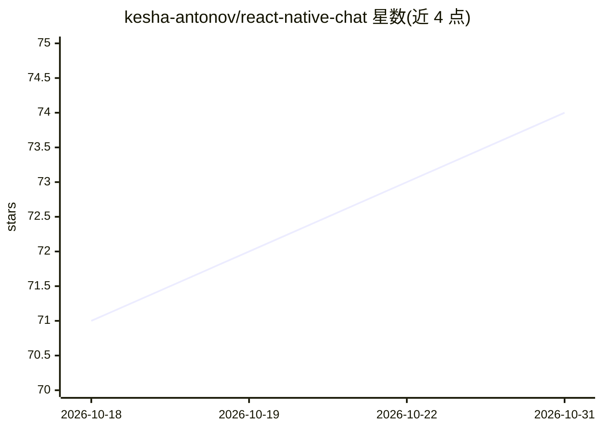

# kesha-antonov/react-native-chat

⭐ 74 · TypeScript · MIT · 推送 2026-10-22 · [GitHub](https://github.com/kesha-antonov/react-native-chat) · [官网](https://kesha-antonov.github.io/react-native-chat/) · 个人维护

**React Native 与 Web 的聊天 UI 组件库，含流式 AI 消息渲染**

面向 React Native / Expo / Web 开发者的聊天界面组件库，是 react-native-gifted-chat 的 fork 与 drop-in 替代（保持相同 IMessage 模型与 props，提供 codemod 迁移）。功能覆盖流式 AI 消息逐 token 渲染、表情回应、滑动作答、快捷回复、音视频消息与录制、位置消息、明暗主题系统与组件级覆盖。通过 npx expo install 或 yarn/npm 安装，裸工程需配置 Babel 插件并安装 iOS pods 后重建原生应用。

## 筛选速览

| 维度 | 判定 | 备注 |
|---|---|---|
| AI 角色 | `ai-ecosystem` | LLM/agent 周边工具 |
| 许可风险 | `permissive` | MIT |
| 部署形态 | `library` | 以包/库形式分发 |
| 模型依赖 | — | README 未给出锁定关系 |
| 硬件要求 | — | 无带数字的原话,不猜 |
| 安装摩擦 | `low` | 无编译、无系统依赖或容器化 |
| 成熟度 | — | 结构信号不足 |

## 能力要点

- 流式 AI 回复逐 token 渲染，带打字光标与停止控制
- react-native-gifted-chat 的 drop-in 替代，IMessage 模型与 props 不变
- 明/暗主题 token 系统，运行时可切换，任意组件可覆盖
- 内置视频/音频消息、语音录制、表情回应、快捷回复

## 适用场景

- 在 React Native 应用中快速搭建聊天界面
- 为 AI 聊天应用渲染流式回复消息
- 从 react-native-gifted-chat 低成本迁移升级 UI

## 场景标签

 · 领域:前端/移动 UI 组件

## 证据(README 行号)

> L85: - 🤖 **Streaming AI messages** - token-by-token replies with a typing caret and stop control
> L14:  Streaming AI reply rendering markdown token by token

## 星数曲线

2026-10-18 71 → 2026-10-31 74（+3）

---
*卡片 v1 · prompt 1.4 · 生成 2026-10-24 · 置信度 high · 依据 README sha `aee40a186088` · [字段定义](../../DATASET.md)*
