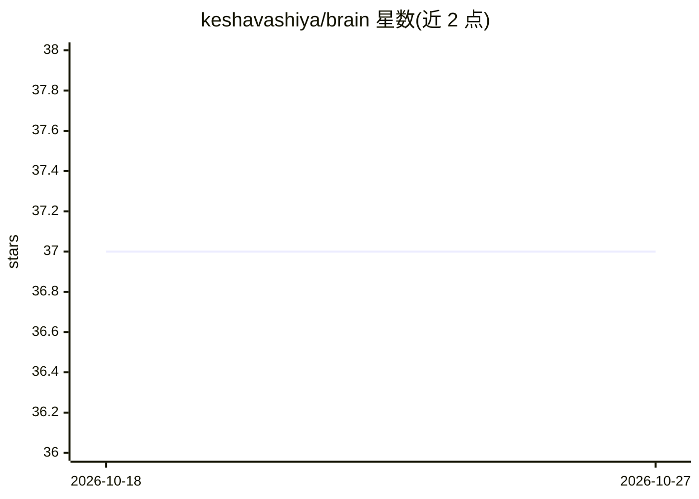

# keshavashiya/brain

⭐ 37 · Rust · MIT · 推送 2026-09-07 · [GitHub](https://github.com/keshavashiya/brain) · [官网](https://keshavashiya.github.io/brain/) · 个人维护

**本地优先的 AI 记忆操作系统，让多个 AI 工具共享统一记忆**

用 Rust 编写的本地记忆引擎与常驻守护进程：将意图分类、重要性评分与记忆存取整合进统一管线，结合 HNSW 向量搜索与 FTS5 全文搜索并经 RRF 融合排序，每 24 小时按遗忘曲线整理记忆。通过 HTTP、WebSocket、gRPC 与 MCP（stdio/HTTP）多协议接入，供 Claude、Cursor 等 AI 客户端共享同一本地记忆库；另提供能力清单与同意/审计/预算网关、主动提醒引擎和 Agent 委派机制。需先安装 Ollama 或任意 OpenAI 兼容 API 作为运行前提。

## 筛选速览

| 维度 | 判定 | 备注 |
|---|---|---|
| AI 角色 | `ai-ecosystem` | LLM/agent 周边工具 |
| 许可风险 | `permissive` | MIT |
| 部署形态 | `library` | 以包/库形式分发 |
| 模型依赖 | local-ok | 支持本地模型 |
| 硬件要求 | — | 无带数字的原话,不猜 |
| 安装摩擦 | `low` | 无编译、无系统依赖或容器化 |
| 成熟度 | — | 结构信号不足 |

## 能力要点

- 多协议接入（HTTP/WebSocket/gRPC/MCP），所有适配器共享单一处理器保持记忆一致
- HNSW 向量搜索 + FTS5 全文搜索混合检索，RRF 融合并按重要性与新近度重排
- 每 24 小时记忆整理：遗忘曲线剪枝低价值片段，强化片段晋升为永久语义事实
- 统一能力清单（capability manifest），所有能力经同意、审计与预算网关路由

## 适用场景

- 让多个 AI 编码助手/聊天工具共享同一份本地长期记忆
- 通过 MCP 客户端（如 Claude、Cursor）检索与写入统一记忆库
- 依赖主动提醒引擎追踪未完成事项与习惯模式

## 场景标签

`Agent 记忆` · 领域:Agent 开发

## 证据(README 行号)

> L11: It routes intents through a Thalamus, scores importance via an Amygdala, and stores everything in a unified Hippoca
> L125: Any MCP-compatible client can connect to Brain as a stdio MCP server:

## 星数曲线

2026-10-18 37 → 2026-10-27 37（+0）

---
*卡片 v1 · prompt 1.4 · 生成 2026-10-25 · 置信度 high · 依据 README sha `e87a4d2bee77` · [字段定义](../../DATASET.md)*
