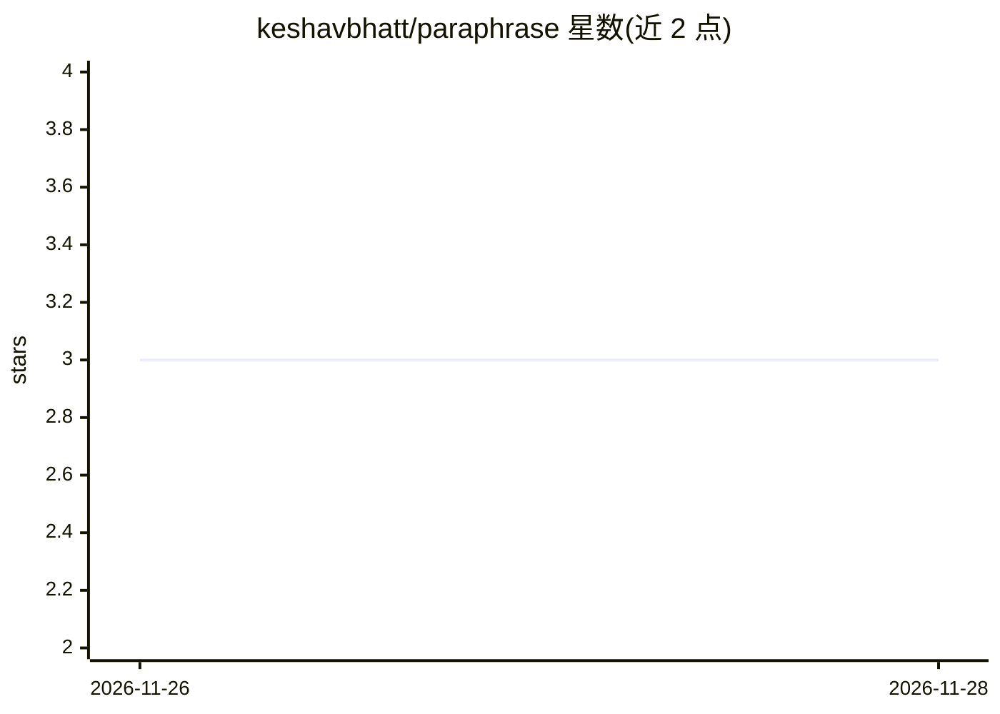

# keshavbhatt/paraphrase

⭐ 3 · C++ · 推送 2026-11-03 · [GitHub](https://github.com/keshavbhatt/paraphrase) · 个人维护

**Linux 离线 AI 写作助手：本地 LLM 校对/改写/翻译**

面向 Linux 桌面的离线写作工具，通过全局快捷键在任意应用中选中文本后调用本地运行的 Gemma 4 模型（llama.cpp 路线），完成校对、语气调整、回复生成、摘要、格式化与翻译（含印地语和 Hinglish）。模型下载后无需联网，历史记录默认关闭、开启后加密存储。架构为 Qt 6 C++ 守护进程加 CLI 与窗口客户端，经 D-Bus 通信；桌面集成当前覆盖 KDE Plasma，GNome 支持仍在开发中。通过 Snap 或 AUR 分发，开发构建依赖 core24 环境并可用 Docker 容器完成。

## 筛选速览

| 维度 | 判定 | 备注 |
|---|---|---|
| AI 角色 | `ai-native` | 本体是模型或模型工具 |
| 许可风险 | `none` | — |
| 部署形态 | `None` |  |
| 模型依赖 | — | README 未给出锁定关系 |
| 硬件要求 | — | 无带数字的原话,不猜 |
| 安装摩擦 | `medium` | 含编译或系统依赖之一 |
| 成熟度 | `idea` | |

## 能力要点

- 全局快捷键在任意应用中选中文本调用改写（KDE Plasma）
- 本地运行 Gemma 4 E2B（8GB 内存）/E4B（16GB 内存）两种模型档位
- 校对结果逐项展示修改并支持单条撤销
- CLI 批处理模式逐行读取 JSON 请求并流式输出

## 适用场景

- 离线环境下校对和润色邮件、文档与帖子
- 在 KDE 桌面通过快捷键对选中文本即时翻译或改写语气
- 用 CLI 批量处理文本改写请求

## 场景标签

`AI 写作` · 领域:内容生成

## 证据(README 行号)

> L5: Paraphrase fixes, rewrites, answers, summarizes and translates your writing with a language
> L24: - **Private**: open models (Gemma 4) run locally; history is off unless you turn it on, and
> L70: daemon/        paraphrase-daemon (C++20, Qt 6): owns the model, does all inference

## 星数曲线

2026-11-26 3 → 2026-11-28 3（+0）

---
*卡片 v1 · prompt 1.4 · 生成 2026-11-26 · 置信度 high · 依据 README sha `ed484565a8c9` · [字段定义](../../DATASET.md)*
