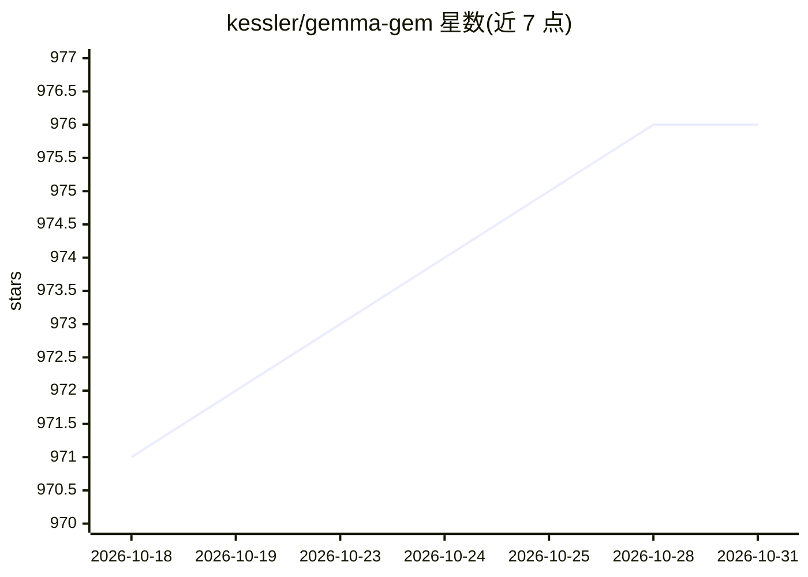

# kessler/gemma-gem

⭐ 976 · TypeScript · Apache-2.0 · 推送 2026-05-29 · [GitHub](https://github.com/kessler/gemma-gem) · 个人维护

**浏览器内本地运行 Gemma 4 的 Chrome AI 助手扩展**

Chrome 扩展，通过 WebGPU 在设备端运行 Google Gemma 4（E2B/E4B，ONNX q4f16 量化，128K 上下文），无需 API key、不联网传数据。提供聊天浮层，可读取页面内容、点击元素、填表、滚动、截图并在页面执行 JavaScript 的 agent 工具循环。架构由承载模型与 agent 循环的 offscreen document、消息路由 service worker 和注入聊天 UI 的 content script 组成。需 Chrome 113+（WebGPU、shader-f16），E2B 约需 4GB 显存/共享内存，从源码 pnpm 构建后以开发者模式加载。

## 筛选速览

| 维度 | 判定 | 备注 |
|---|---|---|
| AI 角色 | `ai-native` | 本体是模型或模型工具 |
| 许可风险 | `permissive` | Apache-2.0 |
| 部署形态 | `library` | 以包/库形式分发 |
| 模型依赖 | — | README 未给出锁定关系 |
| 硬件要求 | — | 无带数字的原话,不猜 |
| 安装摩擦 | `low` | 无编译、无系统依赖或容器化 |
| 成熟度 | `idea` | |

## 能力要点

- WebGPU 设备端推理，无 API key、数据不出本机
- 6 种页面操作工具（读取/点击/输入/滚动/截图/执行 JS）的 agent 循环
- Gemma 4 E2B(~500MB)/E4B(~1.5GB) 可切换，128K 上下文，原生 thinking 开关
- 快捷键、逐站禁用、上下文清除等设置，绑定持久化

## 适用场景

- 浏览网页时让 AI 回答当前页面相关问题
- 通过对话让 AI 代为点按钮、填表单、执行页面操作
- 在不上云、不配置 API key 的前提下使用本地 LLM 助手

## 场景标签

`AI 助手` `浏览器自动化` · 领域:效率与自动化

## 证据(README 行号)

> L3: Your personal AI assistant living right inside the browser. Gemma Gem runs Google's Gemma 4 model entirely on-device
> L36: - **Offscreen document**: Hosts the model via `@huggingface/transformers` + WebGPU. Runs the agent loop.

## 星数曲线

2026-10-18 971 → 2026-10-31 976（+5）

---
*卡片 v1 · prompt 1.4 · 生成 2026-10-21 · 置信度 high · 依据 README sha `59fc9ea928ee` · [字段定义](../../DATASET.md)*
