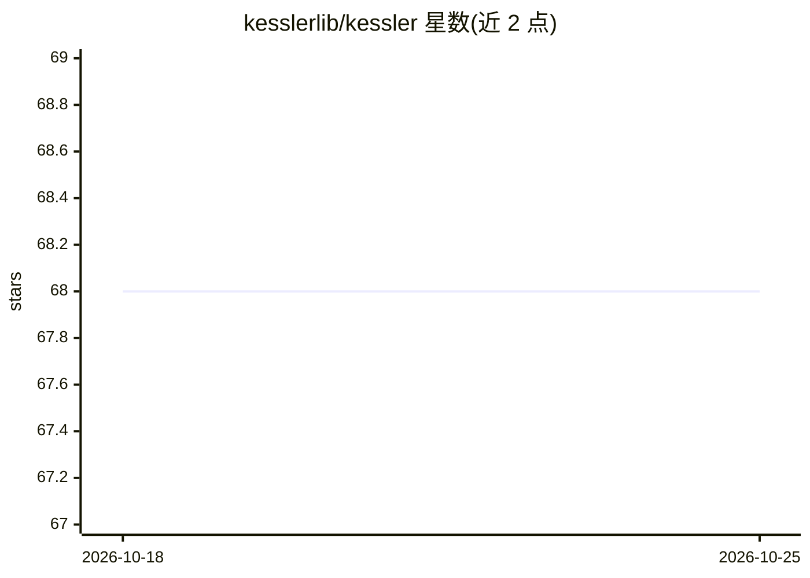

# kesslerlib/kessler

⭐ 69 · Python · GPL-3.0 · 推送 2026-05-15 · [GitHub](https://github.com/kesslerlib/kessler) · [官网](https://kesslerlib.github.io/kessler/) · 组织维护

**面向航天器碰撞规避的机器学习 Python 库**

Kessler 是用于空间碰撞规避与评估的仿真推断与机器学习 Python 库，提供贝叶斯深度学习与概率编程方法进行航天器碰撞风险评估。由 FDL Europe Constellations 团队与欧空局 ESOC 合作发起，主要开发者为 Giacomo Acciarini，团队含牛津大学成员。支持 conda、mamba、pip 及源码本地安装，采用 GPLv3 许可并注明可联系作者商谈其他许可选项；README 引用四篇相关论文。

## 筛选速览

| 维度 | 判定 | 备注 |
|---|---|---|
| AI 角色 | `ai-native` | 本体是模型或模型工具 |
| 许可风险 | `viral` | GPL-3.0 |
| 部署形态 | `library` | 以包/库形式分发 |
| 模型依赖 | — | README 未给出锁定关系 |
| 硬件要求 | — | 无带数字的原话,不猜 |
| 安装摩擦 | `low` | 无编译、无系统依赖或容器化 |
| 成熟度 | — | 结构信号不足 |

## 能力要点

- 仿真推断与机器学习用于空间碰撞规避与评估
- 贝叶斯深度学习与概率编程方法进行碰撞风险评估
- 与欧空局 ESOC 合作发起，附四篇相关论文可引用
- 提供 conda/mamba/pip/源码多种安装方式

## 适用场景

- 航天器交会与碰撞风险的机器学习评估
- 空间碎片环境与碰撞规避研究
- 卫星交会管理相关算法研究

## 场景标签

 · 领域:航天/空间碎片

## 证据(README 行号)

> L19: Kessler is a Python package for simulation-based inference and machine learning for space collision avoidance and a
> L58: * Francesco Pinto, Giacomo Acciarini, Sascha Metz, Sarah Boufelja, Sylvester Kaczmarek, Klaus Merz, José A. Martine

## 星数曲线

2026-10-18 68 → 2026-10-25 68（+0）

---
*卡片 v1 · prompt 1.4 · 生成 2026-10-24 · 置信度 high · 依据 README sha `4f34e91be81a` · [字段定义](../../DATASET.md)*
