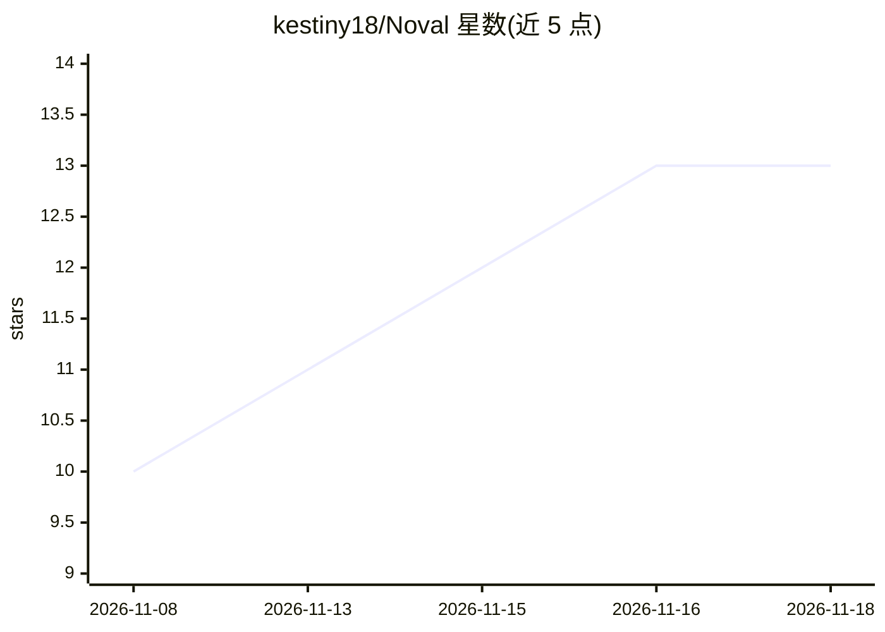

# kestiny18/Noval

⭐ 13 · Python · MIT · 推送 2026-08-02 · [GitHub](https://github.com/kestiny18/Noval) · 个人维护

**面向强模型精简 Agent 的中立执行内核**

Noval 提供 Python 编写的 Agent 执行内核：模型负责规划与策略，内核负责动作授权、执行、观察、恢复与核验。工具经统一解析/校验/权限/脱敏流水线执行，本地文件用路径围栏与符号链接防护，外部进程经单一 ProcessRuntime 并支持 Linux Bubblewrap 沙箱。状态由 append-only 会话历史承载，提供 checkpoint 重建。扩展复用 SKILL.md、stdio MCP 与 hooks.json 格式。要求 Python 3.10+，Phase 1 仅支持 OpenAI 兼容配置，默认接入 DeepSeek，仍处 0.x 版本。

## 筛选速览

| 维度 | 判定 | 备注 |
|---|---|---|
| AI 角色 | `ai-ecosystem` | LLM/agent 周边工具 |
| 许可风险 | `permissive` | MIT |
| 部署形态 | `library` | 以包/库形式分发 |
| 模型依赖 | locked-api |  |
| 硬件要求 | — | 无带数字的原话,不猜 |
| 安装摩擦 | `low` | 无编译、无系统依赖或容器化 |
| 成熟度 | `idea` | |

## 能力要点

- 工具调用统一走解析、校验、权限、脱敏与追踪流水线
- 路径围栏与 Bubblewrap 沙箱报告真实隔离能力
- append-only 会话历史与可重建 checkpoint
- 支持 SKILL.md、stdio MCP 与 Pre/Post/Stop Hooks 扩展

## 适用场景

- 让强模型 Agent 以受控权限执行文件与 shell 操作
- 为 Agent 会话提供可恢复、可审计的持久化状态
- 通过 Hooks 与验收准则对 Agent 结束条件做确定性核验

## 场景标签

`Agent 框架` · 领域:Agent 开发

## 证据(README 行号)

> L24: > **The model owns the method. Noval owns reality, authority, continuity, and evidence.**
> L28: the external world: how an action is authorized, executed, observed, recovered,
> L39: |Tool execution|Central parsing, validation, permission, error, truncation, redaction, and trace pipeline|

## 星数曲线

2026-11-08 10 → 2026-11-18 13（+3）

---
*卡片 v1 · prompt 1.4 · 生成 2026-11-18 · 置信度 high · 依据 README sha `ed45a91ae41c` · [字段定义](../../DATASET.md)*
