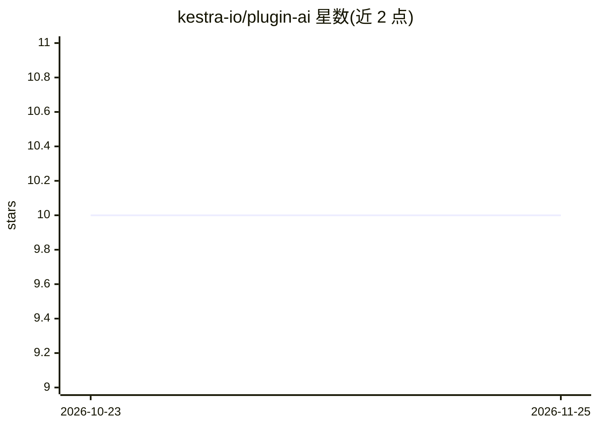

# kestra-io/plugin-ai

⭐ 10 · Java · Apache-2.0 · 推送 2026-11-23 · [GitHub](https://github.com/kestra-io/plugin-ai) · 组织维护

**Kestra 编排平台的 AI 插件，在工作流中接入生成式 AI**

Kestra 事件驱动声明式编排平台的 AI 插件，基于 LangChain4j 在编排工作流中覆盖聊天补全、agents、RAG 与工具调用，提供 `io.kestra.plugin.ai` 下的组件，包括 `AIUtils`、`GoogleCustomWebSearch`、`TavilyWebSearch`、`SqlDatabaseRetriever` 等类。面向需要在同一 Kestra 流程中编排 AI 步骤并衔接上游准备、审批、重试、通知与下游系统的团队。文档位于 kestra.io/docs，插件开发指南另有文档；Apache 2.0 许可。

## 筛选速览

| 维度 | 判定 | 备注 |
|---|---|---|
| AI 角色 | `ai-ecosystem` | LLM/agent 周边工具 |
| 许可风险 | `permissive` | Apache-2.0 |
| 部署形态 | `None` |  |
| 模型依赖 | — | README 未给出锁定关系 |
| 硬件要求 | — | 无带数字的原话,不猜 |
| 安装摩擦 | `low` | 无编译、无系统依赖或容器化 |
| 成熟度 | — | 结构信号不足 |

## 能力要点

- 通过 LangChain4j 在 Kestra 工作流中编排生成式 AI（聊天补全、agents、RAG、工具）
- 提供 `io.kestra.plugin.ai` 插件组件及 AIUtils、网页搜索、SQL 数据库检索等类
- AI 步骤与上游准备、审批、重试、通知和下游系统在同一流程中
- 每月发布新版本

## 适用场景

- 在编排工作流中调用聊天补全与 RAG 流程
- 为依赖 AI 步骤的业务流程接入审批、重试与通知
- 在数据管道中以工作流方式管理 AI 相关步骤

## 场景标签

`工作流自动化` `RAG` · 领域:效率与自动化

## 证据(README 行号)

> L30: - What user problem does this solve? Teams need to orchestrate generative AI in Kestra with LangChain4j, covering c
> L36: - Provides plugin components under `io.kestra.plugin.ai`.

## 星数曲线

2026-10-23 10 → 2026-11-25 10（+0）

---
*卡片 v1 · prompt 1.4 · 生成 2026-11-19 · 置信度 mid · 依据 README sha `0a39396186db` · [字段定义](../../DATASET.md)*
