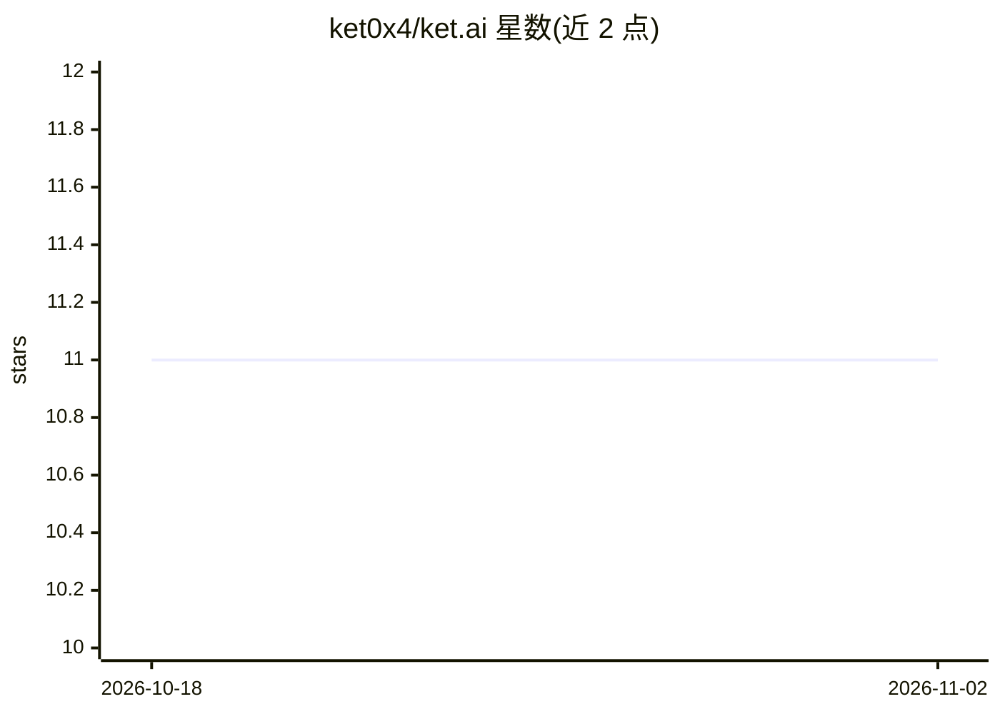

# ket0x4/ket.ai

⭐ 11 · TypeScript · 推送 2026-10-19 · [GitHub](https://github.com/ket0x4/ket.ai) · [官网](https://t.me/Ketardgrambot) · 个人维护

**基于 Gemini 的 Telegram 群聊 AI 机器人，带向量记忆**

用 Bun/TypeScript 编写的 Telegram 聊天机器人，接入 Google Gemini（gemini-3.8-flash / gemini-3.5-flash-lite）生成回复，跟踪对话上下文，可按概率自主加入群聊。提供按群组的混合向量记忆（RAG，最多 10,000 条事实，按用户索引、相似度加新鲜度排序、TTL 分类），后台工作线程从群历史中提取用户事实。支持图像与语音理解、文档处理与沙箱代码执行，以及带安全机制的 agent 工具调用（web_search、execute_code、工作区工具等）。含速率限制与 Mini App 管理面板，通过 Docker 或 Bun 运行。

## 筛选速览

| 维度 | 判定 | 备注 |
|---|---|---|
| AI 角色 | `ai-native` | 本体是模型或模型工具 |
| 许可风险 | `none` | — |
| 部署形态 | `self-host` | docker 或自建部署 |
| 模型依赖 | — | README 未给出锁定关系 |
| 硬件要求 | — | 无带数字的原话,不猜 |
| 安装摩擦 | `low` | 无编译、无系统依赖或容器化 |
| 成熟度 | — | 结构信号不足 |

## 能力要点

- Gemini 驱动回复，带对话上下文与可配置概率的自主发言
- 按群组的混合向量记忆：最多 10,000 条事实，相似度+新鲜度排序，TTL 与过期替换
- 图像/语音理解与沙箱中的文档处理、代码执行
- 带预算与失败升级机制的 agent 工具循环（web_search、execute_bash 等）

## 适用场景

- 在 Telegram 群里部署一个能记住成员信息的聊天机器人
- 通过 /remember 或自然语言让机器人记住并回忆事实
- 让机器人读取文档、运行代码并把结果发回聊天

## 场景标签

`聊天机器人` · 领域:对话与助手

## 证据(README 行号)

> L3: Ket is an AI bot that joins Telegram groups and chats like a fun, opinionated
> L4: buddy rather than a formal assistant. It is powered by Google Gemini, follows
> L9: - Gemini-backed replies (`gemini-3.8-flash` / `gemini-3.5-flash-lite`) with

## 星数曲线

2026-10-18 11 → 2026-11-02 11（+0）

---
*卡片 v1 · prompt 1.4 · 生成 2026-11-02 · 置信度 high · 依据 README sha `759407f96689` · [字段定义](../../DATASET.md)*
