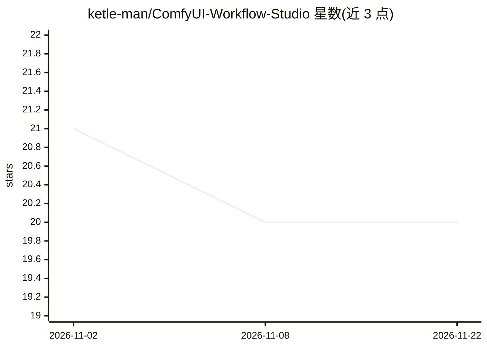

# ketle-man/ComfyUI-Workflow-Studio

⭐ 20 · JavaScript · MIT · 推送 2026-11-21 · [GitHub](https://github.com/ketle-man/ComfyUI-Workflow-Studio) · 个人维护

**ComfyUI 插件：工作流/模型资产管理与批量生图界面**

面向 ComfyUI 用户的多标签页插件：Workflow Tab 以缩略图/表格管理本地工作流库（徽章过滤、全文搜索、JSON 查看、Send to Canvas 直送画布）；GenerateUI 提供跨模型/采样器/提示词/工作流的批量生成、文件夹连续生成与 Lab 迭代实验；Models/Gallery/Video 等标签管理模型、图片元数据与视频工作流（MiniMax H3/LTX-2.5/Wan2.2）。附带 AI 工具：提示词辅助与翻译（通义千问/文心一言等）、基于 Ollama 的工作流摘要、Gallery 语义图像搜索。以 ComfyUI custom node 形式安装。

## 筛选速览

| 维度 | 判定 | 备注 |
|---|---|---|
| AI 角色 | `ai-ecosystem` | LLM/agent 周边工具 |
| 许可风险 | `permissive` | MIT |
| 部署形态 | `desktop` | 安装包/桌面程序 |
| 模型依赖 | local-ok | 支持本地模型 |
| 硬件要求 | — | 无带数字的原话,不猜 |
| 安装摩擦 | `medium` | 含编译或系统依赖之一 |
| 成熟度 | — | 结构信号不足 |

## 能力要点

- 工作流库管理：缩略图/表格视图、徽章过滤、全文搜索、Send to Canvas（UI/API 格式）
- GenerateUI 跨模型/采样器/提示词/工作流批量生成与文件夹 Feeder 连续生成
- GenerateUI Check：加载前判定工作流能否运行（格式转换、可操作性占比，约 20 ms）
- AI 工具：提示词辅助/翻译、Ollama 生成工作流摘要、Gallery 语义图像搜索

## 适用场景

- 整理并复用本地积累的 ComfyUI 工作流与生成参数
- 在统一界面里跨模型与采样器批量生图
- 从图片元数据提取工作流与模型信息并送回画布

## 场景标签

`图像生成` `语义搜索` · 领域:内容生成

## 证据(README 行号)

> L3: A comprehensive workflow, asset management, and generation UI plugin for ComfyUI.
> L12: **⚡ GenerateUI** — a productivity-focused generation tab connected to every other tab

## 星数曲线

2026-11-02 21 → 2026-11-22 20（-1）

---
*卡片 v1 · prompt 1.4 · 生成 2026-11-18 · 置信度 low · 依据 README sha `5267108b3eb5` · [字段定义](../../DATASET.md)*
