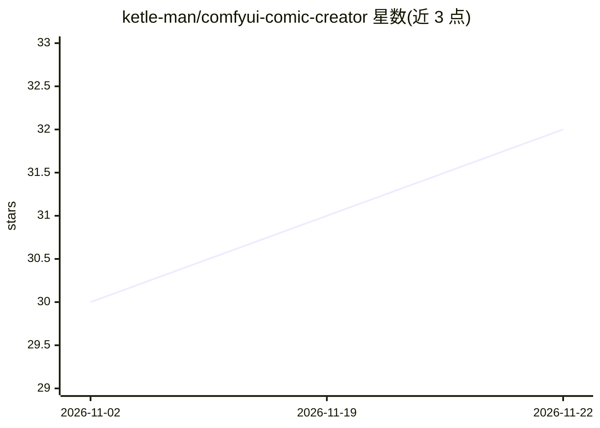

# ketle-man/comfyui-comic-creator

⭐ 32 · JavaScript · MIT · 推送 2026-11-15 · [GitHub](https://github.com/ketle-man/comfyui-comic-creator) · 个人维护 · 中文 README

**运行在 ComfyUI 上的漫画页面制作 SPA 自定义节点**

以 ComfyUI 自定义节点形式提供的单页应用，覆盖漫画制作流程：作品/页面管理、SVG 导入或向导创建分镜模板、向格内配置图像/对话框/文本/形状/3D 姿势，输出 JPEG/PNG/WebP/SVG/PDF/EPUB。提供基于图层的画布编辑器（画笔/蒙版/填充/PSD 读写等）、字体管理、脚本管理与 OCR 文本插入。AI 部分：经 Workflow Studio 的 I2I/T2I 生成、Inpaint/Outpaint 局部重绘（Nanobanana），以及 SAM3 分割。面向使用 ComfyUI 的漫画创作者，需依赖多个联动节点获得完整功能。

## 筛选速览

| 维度 | 判定 | 备注 |
|---|---|---|
| AI 角色 | `ai-enhanced` | 去掉 AI 部分产品仍成立 |
| 许可风险 | `permissive` | MIT |
| 部署形态 | `desktop` | 安装包/桌面程序 |
| 模型依赖 | — | README 未给出锁定关系 |
| 硬件要求 | — | 无带数字的原话,不猜 |
| 安装摩擦 | `low` | 无编译、无系统依赖或容器化 |
| 成熟度 | — | 结构信号不足 |

## 能力要点

- 分层图像编辑器与 SVG/PSD 双向支持，输出含 PDF/EPUB 共 6 种格式
- 经 Workflow Studio 执行 I2I/T2I、Inpaint/Outpaint 生成
- VRM/GLB 3D 姿势摆放与 3D 文字（Three.js 挤出）烧录进画面
- 网点、集中线、背景图案等漫画专用工具与脚本管理/OCR 插字

## 适用场景

- 在 ComfyUI 内一站式排版和绘制漫画页面
- 用 AI 生成/局部重绘填充分格画面，再进行排版与文字加工
- 用 3D 模型摆姿势作为分格草稿或成品素材

## 场景标签

`图像生成` · 领域:内容生成

## 证据(README 行号)

> L5: ComfyUI 上で動作するマンガページ作成 SPA（シングルページアプリケーション）です。作品（ページグループ）単位でページを管理し、テンプレートからページを作成してコマに画像・フキダシ・テキスト・図形・3D ポーズを配置し、JP
> L38: - **Generate 連携**（旧 I2I 連携） — 「Generate」ボタンから、選択画像・ページ全体・コマ単位（プロンプトタブで選択）の3対象を切り替えられるモーダルを開き、その場で Workflow Studio 経

## 星数曲线

2026-11-02 30 → 2026-11-22 32（+2）

---
*卡片 v1 · prompt 1.4 · 生成 2026-11-18 · 置信度 mid · 依据 README sha `2dc832c0c017` · [字段定义](../../DATASET.md)*
