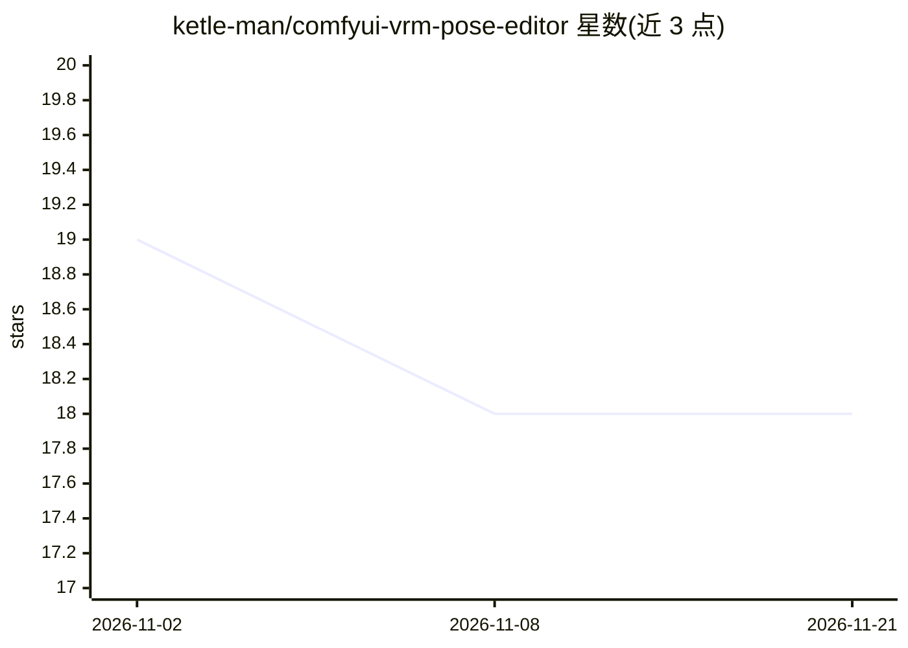

# ketle-man/comfyui-vrm-pose-editor

⭐ 18 · JavaScript · MIT · 推送 2026-11-14 · [GitHub](https://github.com/ketle-man/comfyui-vrm-pose-editor) · 个人维护

**ComfyUI 3D 姿态编辑节点：VRM/GLB/GLTF 摆姿并输出到工作流**

ComfyUI 自定义节点，基于 three.js 与 three-vrm 在浏览器中加载 VRM/GLB/GLTF 模型，通过拖拽骨骼摆姿，在关键帧时间轴上为姿态、相机、灯光制作动画，并将结果（PNG/WebM/MP4/GIF）输出到 ComfyUI 工作流。支持从图像提取人物姿态复制到 VRM（ComfyUI 原生 SAM 3D Body 节点）、自动眨眼、Spring Bone 物理、风力效果、口型同步（可接 Lemonade/VOICEVOX 语音引擎）与 LookAt 目标控制。面向使用 ComfyUI 进行 3D 角色创作的用户。

## 筛选速览

| 维度 | 判定 | 备注 |
|---|---|---|
| AI 角色 | `ai-ecosystem` | LLM/agent 周边工具 |
| 许可风险 | `permissive` | MIT |
| 部署形态 | `None` |  |
| 模型依赖 | — | README 未给出锁定关系 |
| 硬件要求 | — | 无带数字的原话,不猜 |
| 安装摩擦 | `medium` | 含编译或系统依赖之一 |
| 成熟度 | — | 结构信号不足 |

## 能力要点

- VRM/GLB/GLTF 浏览器内骨骼拖拽编辑与关键帧时间轴（姿态/相机/灯光）
- 图像→姿态复制（SAM 3D Body）与自动眨眼
- Spring Bone 物理、正弦波风力效果与风向标记
- 口型同步与 Lemonade/VOICEVOX 音频生成，输出 PNG/WebM/MP4/GIF

## 适用场景

- 在 ComfyUI 中为 VRM 角色摆姿并输出渲染图像或动画
- 从参考图把人物姿态复制到 3D 模型
- 制作带灯光、相机与风力效果的 VRM 动画（WebM/MP4/GIF）

## 场景标签

`图像生成` `视频生成` · 领域:内容生成

## 证据(README 行号)

> L7: An interactive 3D pose editor node for ComfyUI.
> L8: Load VRM / GLB / GLTF models directly in the browser, drag bones to pose them, animate poses/camera/lights on a keyf
> L9: You can also copy a pose from an image onto a VRM (SAM 3D Body via ComfyUI's native nodes) and let VRM models blink 

## 星数曲线

2026-11-02 19 → 2026-11-21 18（-1）

---
*卡片 v1 · prompt 1.4 · 生成 2026-11-18 · 置信度 high · 依据 README sha `26e943cbe920` · [字段定义](../../DATASET.md)*
