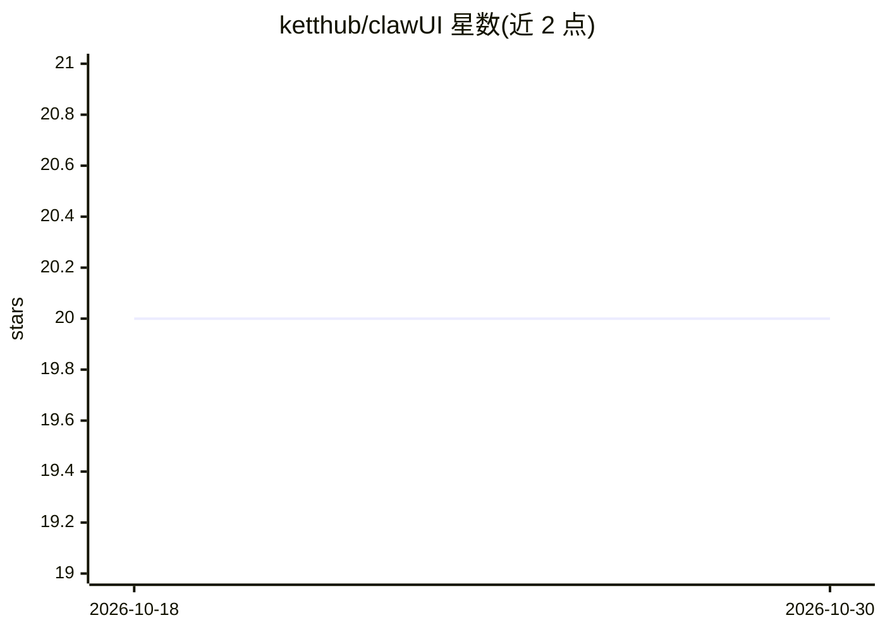

# ketthub/clawUI

⭐ 20 · TypeScript · MIT · 推送 2026-04-04 · [GitHub](https://github.com/ketthub/clawUI) · 个人维护

**已归档的 OpenClaw Gateway 桌面/网页聊天客户端**

基于 React、Vite 与 Electron 构建的 OpenClaw Gateway 客户端，通过 WebSocket 直连本地 Gateway，无需额外后端。功能包括流式 AI 回复、工具调用时间线、会话管理、多 agent 会话、内置文件管理器（浏览/编辑/上传，路径限定在配置根目录内）、斜杠命令、可配置快捷键与字体/主题等 UI 定制。提供 macOS 未签名桌面构建与 Electron 打包命令。项目已因 Anthropic 于 2026 年 4 月禁止通过 OpenClaw 使用订阅配额而归档，不再维护，代码仅供参考；作者声明为 AI 辅助快速开发实验。

## 筛选速览

| 维度 | 判定 | 备注 |
|---|---|---|
| AI 角色 | `ai-ecosystem` | LLM/agent 周边工具 |
| 许可风险 | `permissive` | MIT |
| 部署形态 | `desktop` | 安装包/桌面程序 |
| 模型依赖 | — | README 未给出锁定关系 |
| 硬件要求 | — | 无带数字的原话,不猜 |
| 安装摩擦 | `low` | 无编译、无系统依赖或容器化 |
| 成熟度 | `idea` | |

## 能力要点

- WebSocket 直连 OpenClaw Gateway，无需额外后端
- 工具调用时间线与附件智能嵌入（文本内联、二进制标注）
- 内置文件管理器：编辑/上传/预览 Markdown、代码、图片、PDF
- 桌面端经 claw-fs:// 协议原生访问文件系统

## 适用场景

- 为本地 OpenClaw Gateway 配备功能完整的聊天界面
- 在会话中查看与检查工具调用的参数和输出
- 在客户端内直接浏览和编辑工作区文件

## 场景标签

`聊天机器人` · 领域:对话与助手

## 证据(README 行号)

> L2:  A modern, ChatGPT-style web & desktop client for OpenClaw Gateway.
> L22: OpenClaw's built-in webchat is functional but minimal. ClawUI gives you a full-featured chat interface — session ma
> L26: > **Prerequisites:** Node.js ≥ 22, npm ≥ 10, a running OpenClaw Gateway

## 星数曲线

2026-10-18 20 → 2026-10-30 20（+0）

---
*卡片 v1 · prompt 1.4 · 生成 2026-10-28 · 置信度 high · 依据 README sha `552312019cac` · [字段定义](../../DATASET.md)*
