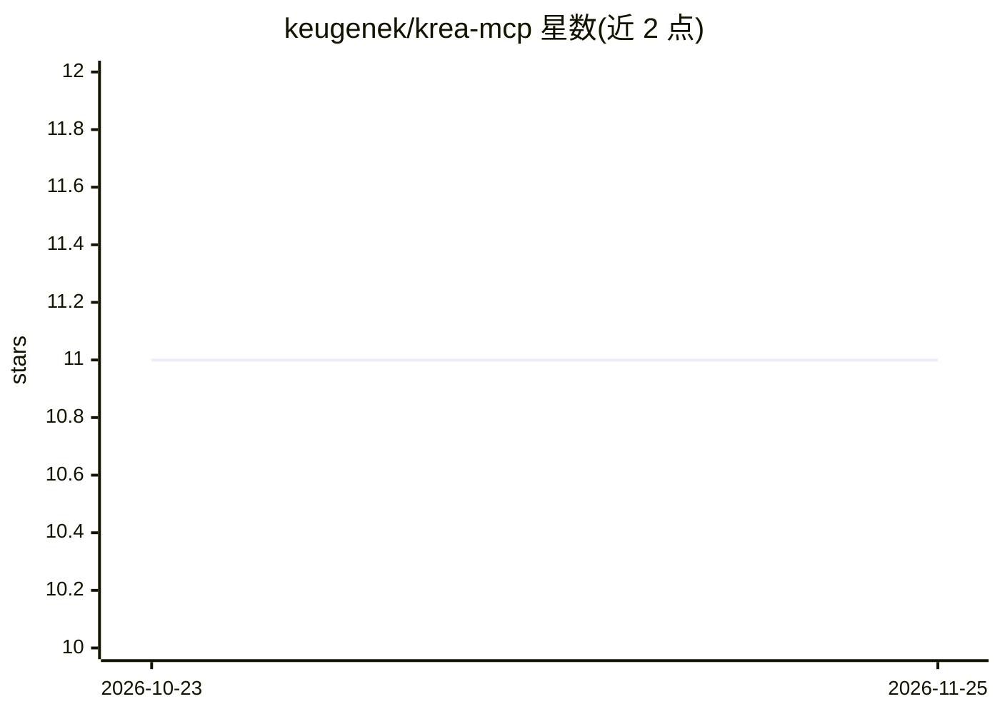

# keugenek/krea-mcp

⭐ 11 · JavaScript · Apache-2.0 · 推送 2026-03-29 · [GitHub](https://github.com/keugenek/krea-mcp) · [官网](https://krea.ai) · 个人维护

**MCP 服务器：让 Claude 等 MCP 客户端调用 Krea.ai 生成图像与视频**

封装 Krea.ai API 的 MCP 服务器，通过统一接口向 MCP 客户端（Claude Desktop、Claude Code、Cursor 等）暴露 20+ 图像/视频生成模型（Flux、Hailuo、Kling、Runway 等）。提供 generate_image、generate_video、任务状态查询、素材上传管理与 LoRA 风格检索共 9 个工具。使用需在 krea.ai 获取 API key；可通过 npx 直接运行，也支持 npm 全局安装；附带 Claude Code 的 /krea 斜杠命令技能。

## 筛选速览

| 维度 | 判定 | 备注 |
|---|---|---|
| AI 角色 | `ai-ecosystem` | LLM/agent 周边工具 |
| 许可风险 | `permissive` | Apache-2.0 |
| 部署形态 | `library` | 以包/库形式分发 |
| 模型依赖 | — | README 未给出锁定关系 |
| 硬件要求 | — | 无带数字的原话,不猜 |
| 安装摩擦 | `low` | 无编译、无系统依赖或容器化 |
| 成熟度 | — | 结构信号不足 |

## 能力要点

- 通过 MCP 协议接入 20+ 图像与视频生成模型
- 9 个工具覆盖生成、任务查询与素材管理
- 支持 LoRA 风格搜索与应用
- npx 免安装运行，附带 Claude Code 斜杠命令

## 适用场景

- 在 Claude Desktop 中用自然语言生成图片和视频
- 为文案生成社交媒体短视频素材
- 检索并应用自定义 LoRA 风格做系列化出图

## 场景标签

`图像生成` `视频生成` · 领域:内容生成

## 证据(README 行号)

> L9: > **MCP server for Krea.ai** - Generate stunning AI images and videos using Flux, Hailuo, Runway, Kling, Ideogram, I
> L26: - **20+ AI Models** - Access Flux, Ideogram, Imagen 4, Runway Gen-4, Hailuo, Kling, Pika, Veo 3, and more through o
> L102: ## Available Tools

## 星数曲线

2026-10-23 11 → 2026-11-25 11（+0）

---
*卡片 v1 · prompt 1.4 · 生成 2026-11-18 · 置信度 high · 依据 README sha `9b8df5bd3cd0` · [字段定义](../../DATASET.md)*
