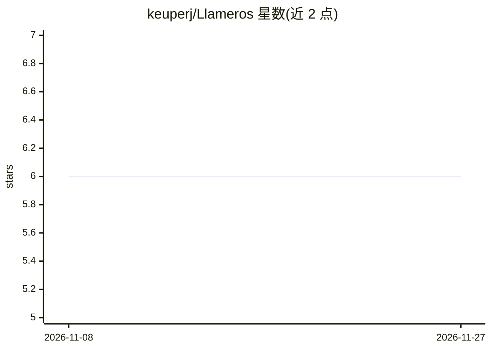

# keuperj/Llameros

⭐ 6 · Python · MIT · 推送 2026-11-24 · [GitHub](https://github.com/keuperj/Llameros) · [官网](https://www.llameros.org) · 组织维护

**Ollama 本地模型管理器：安全共享给多用户**

面向单台本地服务器/工作站向多用户共享 Ollama 模型的管理工具：提供 Web 界面完成模型搜索、推荐、下载与加载，以 rootless Docker 运行模型，附带 CPU/多 GPU 与多模型支持、硬件与用量监控、模型基准测试。通过 host PAM 认证实现多用户，提供 HTTPS 网关与细粒度 API key 管理（用户/模型级 token 限额）。要求 Linux、Python 3.11+、uv、Docker 与 PAM，无需 sudo。

## 筛选速览

| 维度 | 判定 | 备注 |
|---|---|---|
| AI 角色 | `ai-ecosystem` | LLM/agent 周边工具 |
| 许可风险 | `permissive` | MIT |
| 部署形态 | `library` | 以包/库形式分发 |
| 模型依赖 | local-ok | 支持本地模型 |
| 硬件要求 | — | 无带数字的原话,不猜 |
| 安装摩擦 | `low` | 无编译、无系统依赖或容器化 |
| 成熟度 | — | 结构信号不足 |

## 能力要点

- rootless Docker 安全运行模型，无需 sudo 权限
- 多用户支持：PAM 认证（本地用户/LDAP）与 API key 细粒度管理
- CPU、多 GPU、多模型支持及硬件/用量监控
- 模型基准测试与共享基准结果的服务端推荐

## 适用场景

- 团队共用一台本地服务器上的 Ollama 模型
- 为不同用户发放受限额的模型访问 API key
- 收集多硬件环境下的模型基准数据辅助选型

## 场景标签

`AI 助手` · 领域:对话与助手

## 证据(README 行号)

> L6: **Light weight Ollama manger: setup and securely share your local Ollama models.**
> L8: **Usage scenario**: you want to share LLMs running on a **single** local sever/workstation with **multiple** users. 

## 星数曲线

2026-11-08 6 → 2026-11-27 6（+0）

---
*卡片 v1 · prompt 1.4 · 生成 2026-11-20 · 置信度 mid · 依据 README sha `5dca1c7ff3ae` · [字段定义](../../DATASET.md)*
