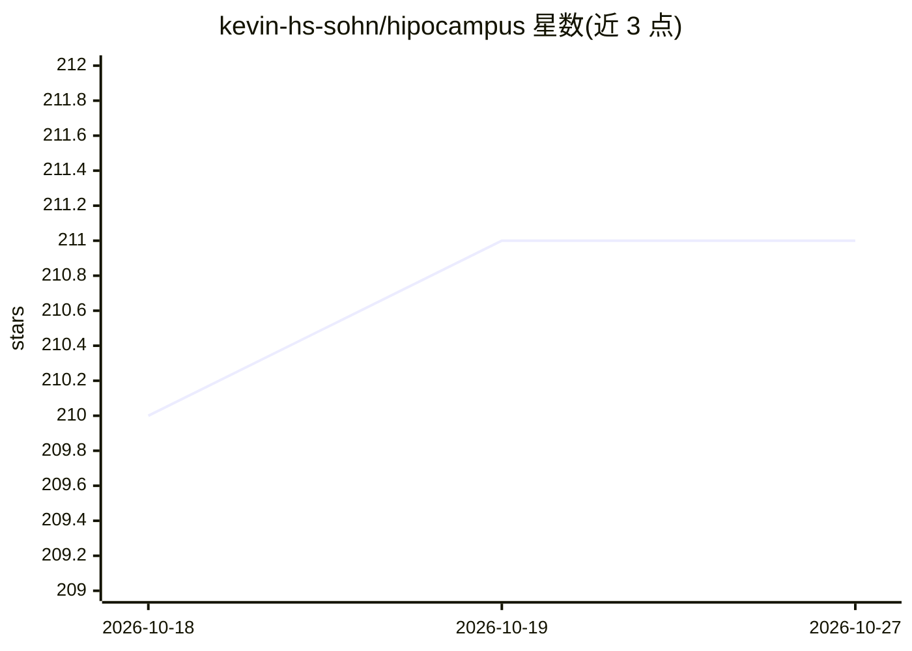

# kevin-hs-sohn/hipocampus

⭐ 211 · JavaScript · MIT · 推送 2026-06-08 · [GitHub](https://github.com/kevin-hs-sohn/hipocampus) · 个人维护

**AI agent 的持久记忆挂载件：三层记忆+压缩树+混合检索**

面向 Claude Code、OpenCode、OpenClaw 等 agent 的文件式记忆系统：以约 3K token 的 ROOT.md 主题索引常驻上下文，配合按需读取的日志/知识库与 BM25+向量混合检索（qmd）及五级压缩树（Raw→Daily→Weekly→Monthly→Root）。记忆分 project/feedback/user/reference 四类并差异化压缩，写入由子代理执行，含密钥扫描脱敏。通过 npx 或 Claude Code 插件市场一条命令安装，向量模式需约 2GB 磁盘。

## 筛选速览

| 维度 | 判定 | 备注 |
|---|---|---|
| AI 角色 | `ai-ecosystem` | LLM/agent 周边工具 |
| 许可风险 | `permissive` | MIT |
| 部署形态 | `library` | 以包/库形式分发 |
| 模型依赖 | — | README 未给出锁定关系 |
| 硬件要求 | — | 无带数字的原话,不猜 |
| 安装摩擦 | `low` | 无编译、无系统依赖或容器化 |
| 成熟度 | — | 结构信号不足 |

## 能力要点

- ~3K token ROOT.md 主题索引每次会话自动加载
- 五级压缩树（Raw→Daily→Weekly→Monthly→Root）自动压实历史
- 三步选择性召回：ROOT.md 分诊→manifest LLM 选择→qmd 混合检索
- 四类记忆差异化压缩，user/feedback 永不压缩

## 适用场景

- 让编程 agent 跨会话记住数月前的技术决策
- 在无人提示的情况下主动关联过去讨论过的上下文
- 给 Claude Code / OpenCode / OpenClaw 加装零基础设施的长期记忆

## 场景标签

`Agent 记忆` · 领域:Agent 开发

## 证据(README 行号)

> L3: Drop-in **proactive memory** harness for AI agents. Zero infrastructure — just files.
> L5: One command to set up. Works immediately with Claude Code, OpenCode, and OpenClaw.

## 星数曲线

2026-10-18 210 → 2026-10-27 211（+1）

---
*卡片 v1 · prompt 1.4 · 生成 2026-10-22 · 置信度 high · 依据 README sha `05697342eedb` · [字段定义](../../DATASET.md)*
