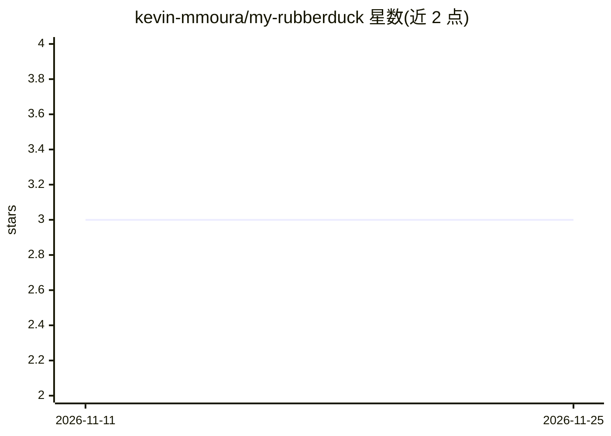

# kevin-mmoura/my-rubberduck

⭐ 3 · MIT · 推送 2026-11-04 · [GitHub](https://github.com/kevin-mmoura/my-rubberduck) · 个人维护

**给 AI 编程代理的编程导师技能：引导思考而非代写代码**

一个发布于 skills.sh 生态的 AI 编程代理技能，本体是 SKILL.md 指令文件，由兼容的编程代理安装后消费，不自带 CLI。设计为"橡皮鸭"角色：不直接给出完整答案，而是通过提问、假设与渐进提示引导用户推理；按用户水平调整引导强度。提供默认辅导、练习、挑战、调试、代码评审、重构六种交互模式，评审时将真实缺陷与风格问题分开归类，重构强调行为不变且经测试验证。MIT 许可。

## 筛选速览

| 维度 | 判定 | 备注 |
|---|---|---|
| AI 角色 | `ai-knowledge` | 知识聚合/清单类 |
| 许可风险 | `permissive` | MIT |
| 部署形态 | `library` | 以包/库形式分发 |
| 模型依赖 | — | README 未给出锁定关系 |
| 硬件要求 | — | 无带数字的原话,不猜 |
| 安装摩擦 | `low` | 无编译、无系统依赖或容器化 |
| 成熟度 | — | 结构信号不足 |

## 能力要点

- 六种交互模式：mentoring/practice/challenge/debug/review/refactor
- 渐进提示优先，完整解答仅在用户要求时给出
- 代码评审将真实缺陷与风格偏好分桶输出
- SKILL.md 与 references/ 文档构成，由兼容 AI 编程代理消费

## 适用场景

- 想学编程时让 AI 代理引导定义问题范围而不是直接要答案
- 用 --debug 模式在提示下自己找出 bug 根因
- 让代理评审自己写的函数并区分缺陷与风格问题

## 场景标签

`代码审查` · 领域:编码与开发

## 证据(README 行号)

> L13:  A programming rubber-duck skill for AI coding agents.
> L67: There's no CLI of your own to run. The skill is instructions consumed by a compatible AI coding agent after install
> L87: `SKILL.md` carries the skill's name, description, goal, instructions, workflow, examples, and the rule that all thr

## 星数曲线

2026-11-11 3 → 2026-11-25 3（+0）

---
*卡片 v1 · prompt 1.4 · 生成 2026-11-21 · 置信度 high · 依据 README sha `47119b4f3504` · [字段定义](../../DATASET.md)*
