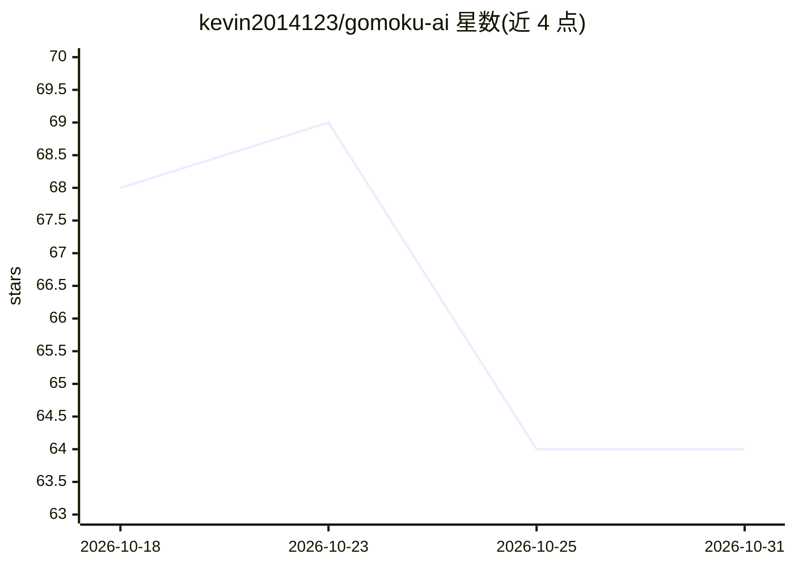

# kevin2014123/gomoku-ai

⭐ 64 · JavaScript · GPL-3.0 · 推送 2026-07-04 · [GitHub](https://github.com/kevin2014123/gomoku-ai) · [官网](https://kevin2014123.github.io/gomoku-ai/) · 个人维护 · 中文 README

**浏览器与安卓可玩的五子棋 AI 对弈游戏，含段位系统**

HTML5/JavaScript 实现的五子棋游戏，内置基于 Minimax 与 Alpha-Beta 剪枝（含迭代加深）的搜索 AI，最高支持 14 层深度搜索，配有棋型识别、位置权重与威胁评估的评估函数，以及移动排序、仅评估相邻位置等优化。提供 AI 对战与双人对战两种模式、8 个难度档位、8 段位积分系统（积分永久保存）。提供在线试玩页面与 APK 下载，采用 GPL-3.0 许可证。

## 筛选速览

| 维度 | 判定 | 备注 |
|---|---|---|
| AI 角色 | `ai-native` | 本体是模型或模型工具 |
| 许可风险 | `viral` | GPL-3.0 |
| 部署形态 | `None` |  |
| 模型依赖 | — | README 未给出锁定关系 |
| 硬件要求 | — | 无带数字的原话,不猜 |
| 安装摩擦 | `low` | 无编译、无系统依赖或容器化 |
| 成熟度 | — | 结构信号不足 |

## 能力要点

- Minimax + Alpha-Beta 剪枝 + 迭代加深，最高 14 层深度搜索
- AI 对战与双人对战两种模式，8 档难度
- 8 个段位的积分系统，积分永久保存
- 评估函数含棋型识别、位置权重与威胁评估

## 适用场景

- 在浏览器或手机上与不同难度的 AI 对弈五子棋
- 与朋友进行双人五子棋对战
- 通过段位积分系统追踪对弈表现

## 场景标签

 · 领域:游戏/博弈 AI

## 证据(README 行号)

> L10: 一个具有多级难度的人工智能五子棋游戏，采用完整的Minimax算法配合Alpha-Beta剪枝优化，支持最高14层深度搜索。
> L33: 核心算法 / Core Algorithm: Minimax + Alpha-Beta剪枝 / Alpha-Beta Pruning + 迭代加深 / Iterative Deepening

## 星数曲线

2026-10-18 68 → 2026-10-31 64（-4）

---
*卡片 v1 · prompt 1.4 · 生成 2026-10-24 · 置信度 high · 依据 README sha `4fcb6d54c3c9` · [字段定义](../../DATASET.md)*
