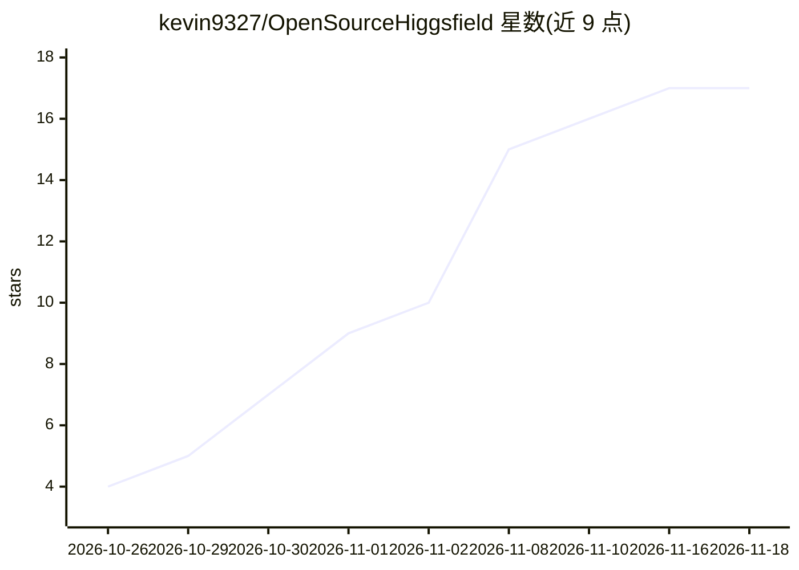

# kevin9327/OpenSourceHiggsfield

⭐ 17 · Python · MIT · 推送 2026-10-17 · [GitHub](https://github.com/kevin9327/OpenSourceHiggsfield) · 个人维护

**基于 ComfyUI 的开源 AI 电影级视频创作平台（三合一工作台）**

为参加 ComfyUI 官方开源挑战赛构建的三合一 AI 视频导演平台，包含四个工作区：电影感摄影棚（6 轴光学重打光）、视频 3D 重摄（球面相机轨道 + CVGEO1 几何流 + Umeyama Sim(3) 轨迹校验）、OpenJutsu 单图角色替换，以及 comfy-sdk 节点图工作台。基于 ComfyUI、LTX-2.5 22B、FLUX.3 等开放权重模型，提供 5 个自定义 ComfyUI 节点与 6 个 API 格式工作流；支持本地开放权重与云端混合两种执行模式，并可作 MCP stdio 服务器供 Claude/Cursor 调用。MIT 许可，Python 依赖安装后经 uvicorn 启动。

## 筛选速览

| 维度 | 判定 | 备注 |
|---|---|---|
| AI 角色 | `ai-native` | 本体是模型或模型工具 |
| 许可风险 | `permissive` | MIT |
| 部署形态 | `library` | 以包/库形式分发 |
| 模型依赖 | — | README 未给出锁定关系 |
| 硬件要求 | — | 无带数字的原话,不猜 |
| 安装摩擦 | `medium` | 含编译或系统依赖之一 |
| 成熟度 | — | 结构信号不足 |

## 能力要点

- 4 个工作区：Cinematic Studio、3D Re-shoot、OpenJutsu、SDK Graph Workbench
- CVGEO1 二进制几何流 + Umeyama Sim(3) 相机轨迹闭环校验（rot_err_deg / fidelity_score_100）
- 5 个自定义 ComfyUI PyTorch 节点与 6 个 ComfyUI API 格式工作流
- MCP JSON-RPC 服务器暴露 6 个 AI Director 工具，支持 stdio 与 HTTP

## 适用场景

- 用开放权重模型在本地生成电影级镜头与图生视频动画
- 对已有视频做交互式 3D 轨道重摄并校验相机轨迹误差
- 用单张角色参考图替换表演视频中的人物并保留同步音频
- 把视频生成能力作为 MCP 工具接入 Claude/Cursor 等客户端

## 场景标签

`图像生成` `视频生成` · 领域:内容生成

## 证据(README 行号)

> L14: **OpenSourceHiggsfield** is a 100% open-source, MIT-licensed **3-in-1 AI Cinema & Video Direction Platform** built 
> L100:  Implements a standard Model Context Protocol (MCP) JSON-RPC 2.0 server (`initialize`, `tools/list`, `tools/call`)

## 星数曲线

2026-10-26 4 → 2026-11-18 17（+13）

---
*卡片 v1 · prompt 1.4 · 生成 2026-11-18 · 置信度 high · 依据 README sha `3c0d75237c1f` · [字段定义](../../DATASET.md)*
