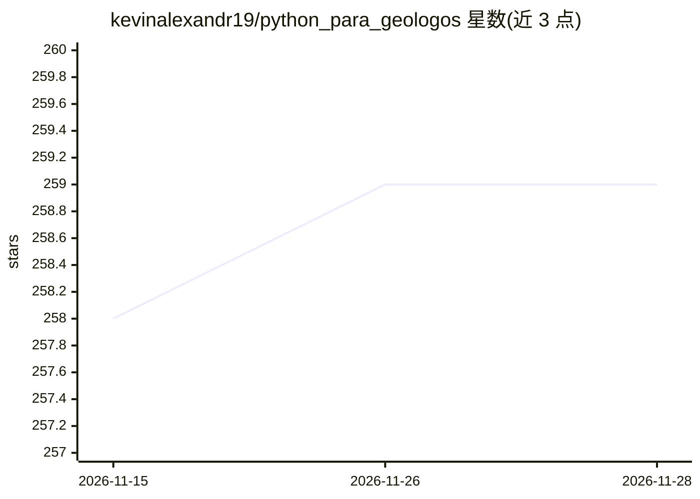

# kevinalexandr19/python_para_geologos

⭐ 259 · Jupyter Notebook · MIT · 推送 2026-11-18 · [GitHub](https://github.com/kevinalexandr19/python_para_geologos) · [官网](https://kevinalexandr19.github.io/python_para_geologos/lab/index.html) · 个人维护

**面向地质学者与学生的 Python 地质编程教程笔记本集**

以 Jupyter Notebook 组织的地质学 Python 教学项目（2.6 版，2025 年 7 月），章节涵盖 Python 基础、统计与数学、数据科学与机器学习（回归、决策树、XGBoost、PCA、聚类、神经网络）、以及地质统计、地球化学、空间分析等地质应用。读者为地质学及相关领域的学生与从业者，需具备地质、统计与线性代数基础。内容可通过 JupyterLite 在线运行，无需安装 Python；本地使用需按教程安装 Python 与 JupyterLab。部分笔记本仍标注为开发中。

## 筛选速览

| 维度 | 判定 | 备注 |
|---|---|---|
| AI 角色 | `ai-knowledge` | 知识聚合/清单类 |
| 许可风险 | `permissive` | MIT |
| 部署形态 | `None` |  |
| 模型依赖 | — | README 未给出锁定关系 |
| 硬件要求 | — | 无带数字的原话,不猜 |
| 安装摩擦 | `low` | 无编译、无系统依赖或容器化 |
| 成熟度 | — | 结构信号不足 |

## 能力要点

- 以 .ipynb 笔记本组织的地质学 Python 课程，覆盖基础、统计、机器学习与地质应用
- 提供 JupyterLite 在线运行选项，无需安装 Python
- 包含钻孔 3D 可视化等工作模板与练习题及解答

## 适用场景

- 系统学习用 Python 解决地质学问题
- 学习机器学习方法在地质数据上的应用（回归、聚类、神经网络）
- 以仓库内容为模板编写自己的地质分析笔记本

## 场景标签

`教程课程` · 领域:学习与行业

## 证据(README 行号)

> L18: Este proyecto académico fue creado con la finalidad de facilitar el aprendizaje en Python para estudiantes y profes
> L26: Todos los capítulos están disponibles dentro del repositorio como notebooks de Jupyter `.ipynb`.
> L127: - A través de JupyterLite, la opción del proyecto para ejecutar los notebooks disponibles sin instalar Python.

## 星数曲线

2026-11-15 258 → 2026-11-28 259（+1）

---
*卡片 v1 · prompt 1.4 · 生成 2026-11-25 · 置信度 high · 依据 README sha `6cfa1a94c907` · [字段定义](../../DATASET.md)*
