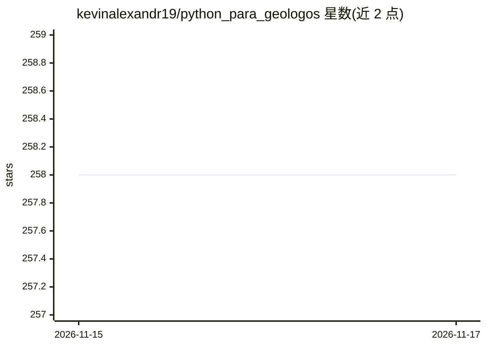

# kevinalexandr19/python_para_geologos

⭐ 258 · Jupyter Notebook · MIT · 推送 2026-11-16 · [GitHub](https://github.com/kevinalexandr19/python_para_geologos) · [官网](https://kevinalexandr19.github.io/python_para_geologos/lab/index.html) · 个人维护

**面向地质学学生的 Python 与机器学习教学笔记本集**

由 Kevin Alexander Gómez 维护的学术教学项目，以 Jupyter 笔记本形式讲授面向地质学的 Python 编程、统计学、数据科学与机器学习（回归、随机森林、PCA、神经网络等），并覆盖地球物理、地球化学、矿产勘查等地质应用章节。面向地质及相关专业学生与从业者，建议先具备普通地质学、统计与线性代数基础。可通过 JupyterLite 在浏览器中免安装运行，或下载后用 Jupyter Lab / Google Colab / VS Code 打开；部分章节标注为开发中。

## 筛选速览

| 维度 | 判定 | 备注 |
|---|---|---|
| AI 角色 | `ai-knowledge` | 知识聚合/清单类 |
| 许可风险 | `permissive` | MIT |
| 部署形态 | `None` |  |
| 模型依赖 | — | README 未给出锁定关系 |
| 硬件要求 | — | 无带数字的原话,不猜 |
| 安装摩擦 | `low` | 无编译、无系统依赖或容器化 |
| 成熟度 | — | 结构信号不足 |

## 能力要点

- 以 .ipynb 笔记本组织，含练习与解答章节
- 覆盖机器学习（监督/无监督/深度学习）与地质应用章节
- 提供 JupyterLite 免安装浏览器运行方式
- 附地质工作模板（3D 钻孔可视化）与参考文献列表

## 适用场景

- 地质专业学生系统学习 Python 编程与数据分析
- 地质从业者学习将机器学习应用于地球化学、地球物理等问题
- 不安装 Python 直接在浏览器中练习代码

## 场景标签

`教程课程` · 领域:学习与行业

## 证据(README 行号)

> L18: Este proyecto académico fue creado con la finalidad de facilitar el aprendizaje en Python para estudiantes y profes
> L70: - Ciencia de datos y Machine Learning
> L89: - Aplicaciones en Geología

## 星数曲线

2026-11-15 258 → 2026-11-17 258（+0）

---
*卡片 v1 · prompt 1.4 · 生成 2026-11-17 · 置信度 high · 依据 README sha `3dd54a1a6f4e` · [字段定义](../../DATASET.md)*
