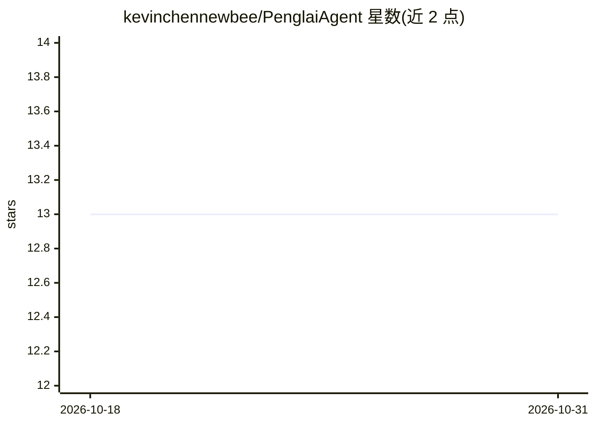

# kevinchennewbee/PenglaiAgent

⭐ 13 · JavaScript · MIT · 推送 2026-10-26 · [GitHub](https://github.com/kevinchennewbee/PenglaiAgent) · [官网](https://penglai.pages.dev) · 个人维护 · 中文 README

**面向个人用户的 DeepSeek Harness 桌面发行版（含插件生态）**

蓬莱是 DeepSeek Harness（DSH）的本地优先桌面发行版：DSH 作为唯一 Agent 核心负责模型、工具、审批、Workspace 与会话，蓬莱提供原生安装包（Apple Silicon DMG、Windows x64 NSIS、统信 UOS 龙芯 deb）、首次引导、本地目录、生命周期监督与更新机制。0.6.6 固定官方 DSH 0.1.7-alpha.2 及 323 个源码包 cohort。内置第一方插件：Workspace 记忆、7 类移动消息通道（默认未配置）、SenseVoice 本地语音识别与 MOSS-TTS 本地语音生成（默认关闭）。限制：macOS 未公证、Windows 无 Authenticode；UOS 真机验收延后。

## 筛选速览

| 维度 | 判定 | 备注 |
|---|---|---|
| AI 角色 | `ai-native` | 本体是模型或模型工具 |
| 许可风险 | `permissive` | MIT |
| 部署形态 | `desktop` | 安装包/桌面程序 |
| 模型依赖 | locked-api |  |
| 硬件要求 | — | 无带数字的原话,不猜 |
| 安装摩擦 | `low` | 无编译、无系统依赖或容器化 |
| 成熟度 | `idea` | |

## 能力要点

- 三平台原生安装包并附 SHA-256 校验与不可变发布流程
- Workspace 级项目记忆，跨项目不可默认互查
- 本地 SenseVoice ASR 与 MOSS-TTS，模型权重固定版本下载
- 无蓬莱账号、无遥测后台、无云端记忆同步

## 适用场景

- 在个人电脑上安装运行 DeepSeek Harness 桌面工作区
- 把 AI 助手接入微信、飞书、Telegram 等消息通道
- 获得带本地语音识别与语音生成的离线语音助手

## 场景标签

`AI 助手` `语音 Agent` · 领域:对话与助手

## 证据(README 行号)

> L37: Penglai is a desktop distribution of DeepSeek Harness. DSH remains the one
> L166: 蓬莱是 DeepSeek Harness 的桌面发行版。DSH 始终是唯一 Agent 核心，负责模型、工具、

## 星数曲线

2026-10-18 13 → 2026-10-31 13（+0）

---
*卡片 v1 · prompt 1.4 · 生成 2026-10-31 · 置信度 mid · 依据 README sha `fada034c7ea9` · [字段定义](../../DATASET.md)*
