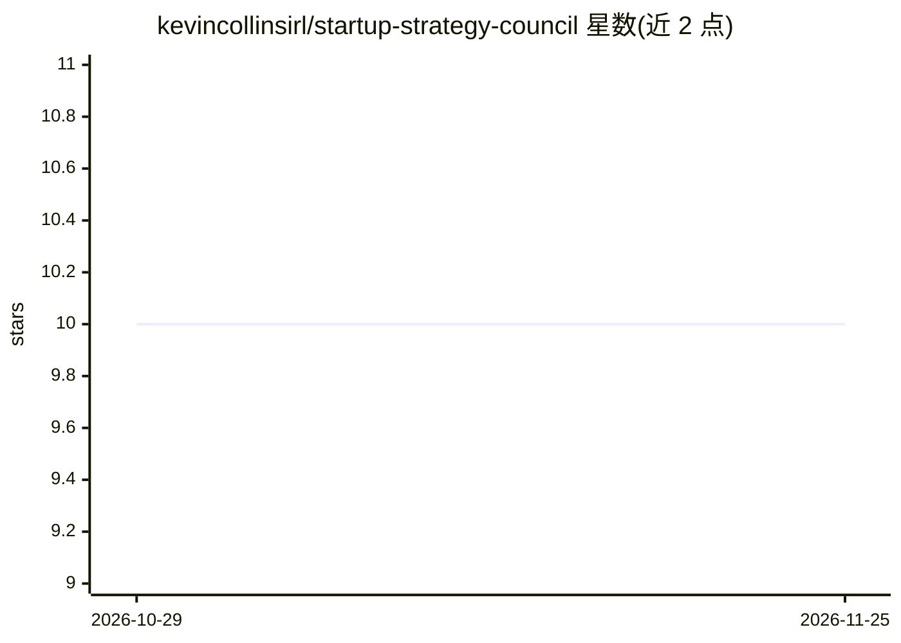

# kevincollinsirl/startup-strategy-council

⭐ 10 · TypeScript · Apache-2.0 · 推送 2026-01-05 · [GitHub](https://github.com/kevincollinsirl/startup-strategy-council) · [官网](https://echofold.ai) · 个人维护

**面向初创的 6 个 AI agent 决策咨询系统**

基于 Next.js 的 Web 应用，围绕初创公司的战略决策提供多 agent 分析：6 个专职 agent（财务、市场、风险、博弈论、资源分配、参谋长）基于用户录入的公司财务、目标与市场数据独立评估各选项；分歧明显的 agent 会进行辩论，由参谋长综合为带置信度、关键理由与异议意见的推荐。数据以文件型 JSON 存储，支持决策历史追踪与业务线监控。AI 推理经由 Claude CLI 或 OpenAI API 完成。

## 筛选速览

| 维度 | 判定 | 备注 |
|---|---|---|
| AI 角色 | `ai-native` | 本体是模型或模型工具 |
| 许可风险 | `permissive` | Apache-2.0 |
| 部署形态 | `library` | 以包/库形式分发 |
| 模型依赖 | locked-api |  |
| 硬件要求 | — | 无带数字的原话,不猜 |
| 安装摩擦 | `low` | 无编译、无系统依赖或容器化 |
| 成熟度 | — | 结构信号不足 |

## 能力要点

- 6 个专职 agent 独立评估并对分歧立场进行辩论
- 基于 agent 共识度生成置信度与异议意见
- 首次启动向导收集公司财务、目标与市场数据（TAM/SAM/SOM）
- 支持 Claude CLI 与 OpenAI API 两种推理通道

## 适用场景

- 为业务方向选择等战略决策获取多角度分析
- 把公司财务与市场数据沉淀后反复做决策评估
- 回顾过往决策结果并追踪

## 场景标签

`多智能体` `AI 助手` `数据分析` · 领域:Agent 开发

## 证据(README 行号)

> L8: > **Multi-agent AI strategic decision system for startups.** Get recommendations from 6 specialized AI agents that d
> L71: 2. **Run the Council** - Each of the 6 agents independently evaluates all options based on your company context
> L110: - **AI**: Claude CLI or OpenAI API

## 星数曲线

2026-10-29 10 → 2026-11-25 10（+0）

---
*卡片 v1 · prompt 1.4 · 生成 2026-11-19 · 置信度 mid · 依据 README sha `bcec8ddbdb73` · [字段定义](../../DATASET.md)*
