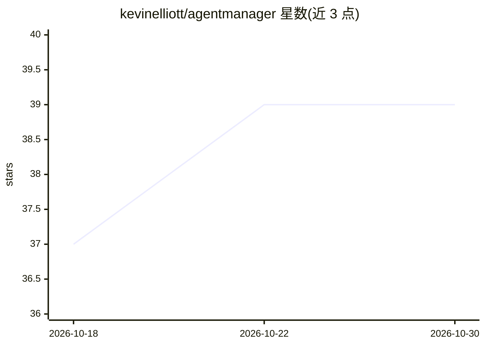

# kevinelliott/agentmanager

⭐ 39 · Go · MIT · 推送 2026-10-29 · [GitHub](https://github.com/kevinelliott/agentmanager) · 个人维护

**AI Agent CLI 工具的检测、安装与更新管理器（CLI/TUI）**

用 Go 编写的 CLI/TUI/库三形态应用，面向在 macOS/Linux/Windows 上使用多个 AI 开发 CLI agent（如 Claude Code、Aider、Gemini CLI 等）的开发者：自动检测已安装的 agent，从 npm/PyPI/Homebrew 等注册表检查版本并安装、更新，内嵌 309 个 agent 的离线目录，支持并行版本检查（10–20 倍于串行速度）。另提供 Bubble Tea TUI、系统托盘后台助手、REST/gRPC API 与检测插件机制。安装方式含 Homebrew、go install 与源码编译。

## 筛选速览

| 维度 | 判定 | 备注 |
|---|---|---|
| AI 角色 | `ai-ecosystem` | LLM/agent 周边工具 |
| 许可风险 | `permissive` | MIT |
| 部署形态 | `library` | 以包/库形式分发 |
| 模型依赖 | — | README 未给出锁定关系 |
| 硬件要求 | — | 无带数字的原话,不猜 |
| 安装摩擦 | `low` | 无编译、无系统依赖或容器化 |
| 成熟度 | — | 结构信号不足 |

## 能力要点

- 自动检测本机已安装的 AI CLI agent 并并行检查版本更新
- 内嵌 309 个 agent 的离线目录，fresh install 即可用 list 命令
- 支持 npm/pip/pipx/uv/Homebrew/原生安装器等多种安装通道
- 提供 TUI、系统托盘助手、REST/gRPC API 与插件机制

## 适用场景

- 统一管理机器上多个 AI CLI agent 的安装与更新
- 批量查看各 agent 当前版本与可用更新
- 通过 REST/gRPC API 将 agent 管理集成到其他工具

## 场景标签

 · 领域:开发者工具/AI agent 管理

## 证据(README 行号)

> L13: A comprehensive CLI/TUI/Library application for detecting, managing, installing, and updating AI development CLI ag
> L19: - **Agent Detection**: Automatically detect installed AI CLI agents (Claude Code, Amp, Aider, GitHub Copilot CLI, G
> L20: - **Version Management**: Check for updates from package registries (npm, PyPI, Homebrew) and manage agent versions

## 星数曲线

2026-10-18 37 → 2026-10-30 39（+2）

---
*卡片 v1 · prompt 1.4 · 生成 2026-10-25 · 置信度 mid · 依据 README sha `2e08304d4120` · [字段定义](../../DATASET.md)*
