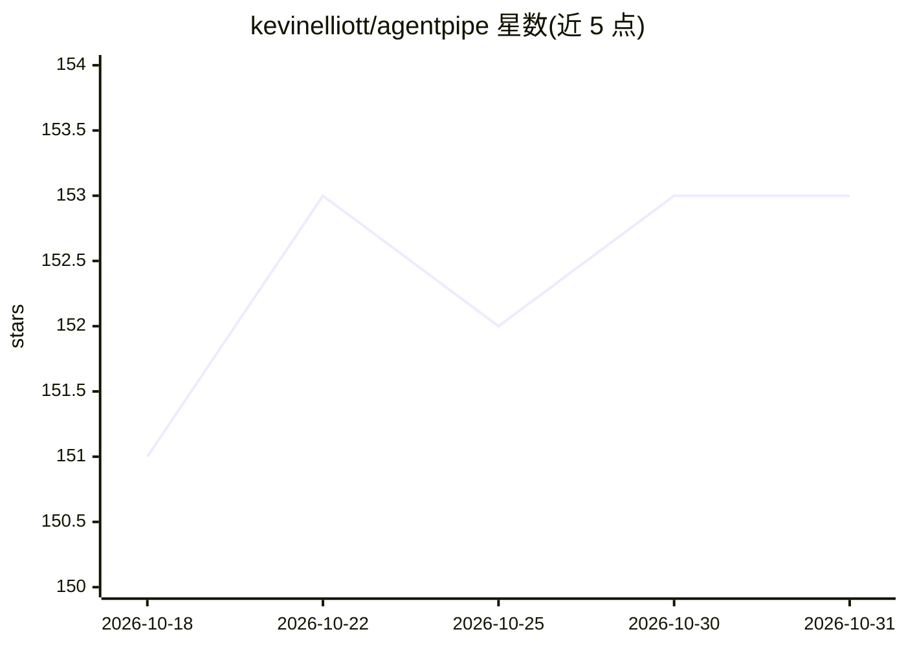

# kevinelliott/agentpipe

⭐ 153 · Go · MIT · 推送 2026-06-27 · [GitHub](https://github.com/kevinelliott/agentpipe) · [官网](https://agentpipe.ai) · 个人维护

**让多个 AI CLI 工具在共享房间对话的多智能体编排 CLI**

Go 编写的 CLI/TUI 应用，将 Claude、Gemini、Qwen、Codex、Copilot 等 AI CLI 工具接入同一共享会话房间，组织多智能体对话；支持 round-robin/reactive/free-form 三种对话模式、实时指标与成本追踪、Prometheus 监控、限流重试、会话保存导出与用户加入对话。要求本机至少安装一个受支持的 AI CLI 工具，Ollama 支持为规划中。提供 Homebrew、install 脚本、go install 与源码构建四种安装方式。

## 筛选速览

| 维度 | 判定 | 备注 |
|---|---|---|
| AI 角色 | `ai-ecosystem` | LLM/agent 周边工具 |
| 许可风险 | `permissive` | MIT |
| 部署形态 | `self-host` | docker 或自建部署 |
| 模型依赖 | locked-api |  |
| 硬件要求 | — | 无带数字的原话,不猜 |
| 安装摩擦 | `low` | 无编译、无系统依赖或容器化 |
| 成熟度 | — | 结构信号不足 |

## 能力要点

- 接入 16 种 AI CLI/API 工具到共享会话（Claude、Gemini、Qwen、Codex、Copilot、OpenRouter 等）
- 三种对话模式：round-robin / reactive / free-form
- TUI 多面板界面含实时响应时长、token 与成本指标
- Prometheus 指标、速率限制、指数退避重试与会话保存/导出

## 适用场景

- 让两个及以上 AI CLI 工具就同一话题自动讨论
- 以用户身份加入多智能体对话并实时查看成本
- 观察和比较不同 AI agent 对同一提示的输出

## 场景标签

`多智能体` · 领域:Agent 开发

## 证据(README 行号)

> L13: AgentPipe is a powerful CLI and TUI application that orchestrates conversations between multiple AI agents. It allo
> L49: - **Multi-Agent Conversations**: Connect multiple AI agents in a single conversation

## 星数曲线

2026-10-18 151 → 2026-10-31 153（+2）

---
*卡片 v1 · prompt 1.4 · 生成 2026-10-22 · 置信度 mid · 依据 README sha `acf0409b7a7a` · [字段定义](../../DATASET.md)*
