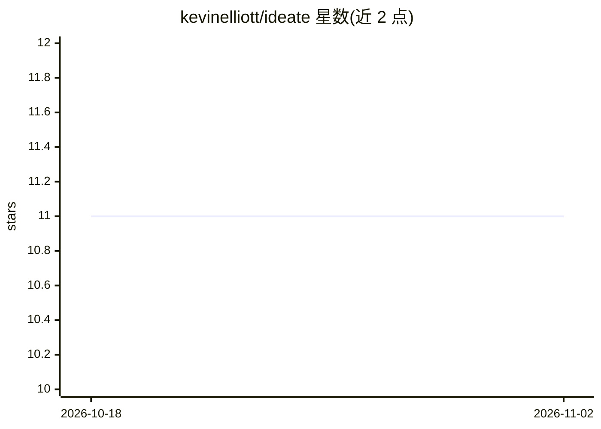

# kevinelliott/ideate

⭐ 11 · TypeScript · 推送 2026-09-10 · [GitHub](https://github.com/kevinelliott/ideate) · [官网](https://ideate.sh) · 个人维护

**管理 AI 编程 agent 工作流的桌面应用：从想法到应用**

基于 React 与 Tauri 2 构建的桌面应用，用于管理 AI 编程 agent 的构建工作流：输入一两句想法后生成含用户故事与验收标准的 PRD，再以顺序（Ralph）、并行或手动三种模式驱动 agent 执行。集成终端实时查看 agent 输出，并提供 API 用量与成本跟踪。支持 8 种 AI 编程工具（Claude Code、Cursor、Codex 等）。安装需 Node.js 20.19+/22.12+、pnpm 9+、Rust 1.70+、Bun 等前置依赖，从源码克隆构建运行。

## 筛选速览

| 维度 | 判定 | 备注 |
|---|---|---|
| AI 角色 | `ai-ecosystem` | LLM/agent 周边工具 |
| 许可风险 | `none` | — |
| 部署形态 | `library` | 以包/库形式分发 |
| 模型依赖 | — | README 未给出锁定关系 |
| 硬件要求 | — | 无带数字的原话,不猜 |
| 安装摩擦 | `low` | 无编译、无系统依赖或容器化 |
| 成熟度 | — | 结构信号不足 |

## 能力要点

- 一句话想法生成含用户故事与验收标准的完整 PRD
- 顺序/并行/手动三种 agent 执行模式
- 支持 8 种 AI 编程 agent（Claude Code、Amp、Codex、Cursor 等）
- 集成终端实时输出与 API 成本跟踪

## 适用场景

- 把产品想法交给 AI agent 流水线自动生成完整应用
- 并行调度多个 AI 编程 agent 同时处理独立用户故事
- 统一管理想法、用户故事与构建进度并跟踪 API 成本

## 场景标签

`编码 Agent` · 领域:编码与开发

## 证据(README 行号)

> L10: Ideate is a desktop application for managing AI coding agent workflows. Start with a simple idea, and let AI agents
> L134: ## Supported AI Agents

## 星数曲线

2026-10-18 11 → 2026-11-02 11（+0）

---
*卡片 v1 · prompt 1.4 · 生成 2026-11-02 · 置信度 mid · 依据 README sha `b3392aa0f311` · [字段定义](../../DATASET.md)*
