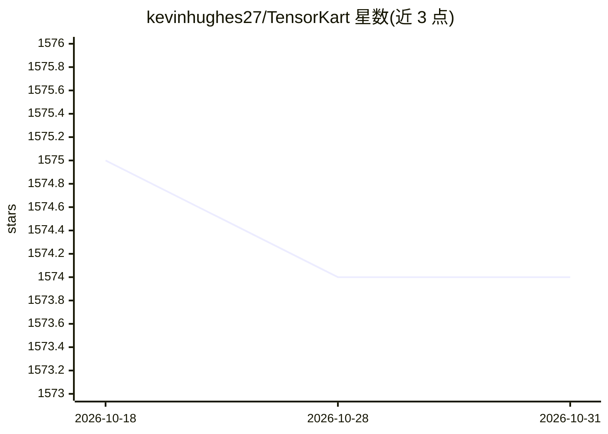

# kevinhughes27/TensorKart

⭐ 1,574 · Python · MIT · 推送 2026-08-03 · [GitHub](https://github.com/kevinhughes27/TensorKart) · 个人维护

**用 TensorFlow 训练 AI 自动驾驶 MarioKart 64 的项目**

基于 TensorFlow 的 Mario Kart 64 自动驾驶实验项目：通过 mupen64plus 模拟器截取游戏画面，用 record.py 配合摇杆录制人类驾驶样本（截图+摇杆轴/按键输出），经 utils.py 整理为训练矩阵后由 train.py 训练模型（使用 cuDNN GPU 加速），最后由 play.py 在 gym-mupen64plus 环境中执行训练好的 agent 输出摇杆指令。作者用 8 场比赛的小样本训练，模型有时能泛化到未见过的赛道。需要用户自备游戏与摇杆。

## 筛选速览

| 维度 | 判定 | 备注 |
|---|---|---|
| AI 角色 | `ai-native` | 本体是模型或模型工具 |
| 许可风险 | `permissive` | MIT |
| 部署形态 | `library` | 以包/库形式分发 |
| 模型依赖 | — | README 未给出锁定关系 |
| 硬件要求 | — | 无带数字的原话,不猜 |
| 安装摩擦 | `low` | 无编译、无系统依赖或容器化 |
| 成熟度 | — | 结构信号不足 |

## 能力要点

- 录制人类驾驶样本生成截图+摇杆输出训练数据
- train.py 使用 TensorFlow 与 cuDNN GPU 加速训练
- play.py 在 gym-mupen64plus 环境中执行训练后的 agent
- 摇杆 LB 键可随时覆盖 AI 指令

## 适用场景

- 我想让 AI 学会自己开 Mario Kart 64
- 学习行为克隆/模仿学习在游戏驾驶上的应用
- 作为游戏 AI 实验项目阅读和改进（如加入强化学习）

## 场景标签

 · 领域:游戏 AI/机器学习实验

## 证据(README 行号)

> L3: self-driving MarioKart with TensorFlow

## 星数曲线

2026-10-18 1,575 → 2026-10-31 1,574（-1）

---
*卡片 v1 · prompt 1.4 · 生成 2026-10-21 · 置信度 high · 依据 README sha `a63564c741a0` · [字段定义](../../DATASET.md)*
