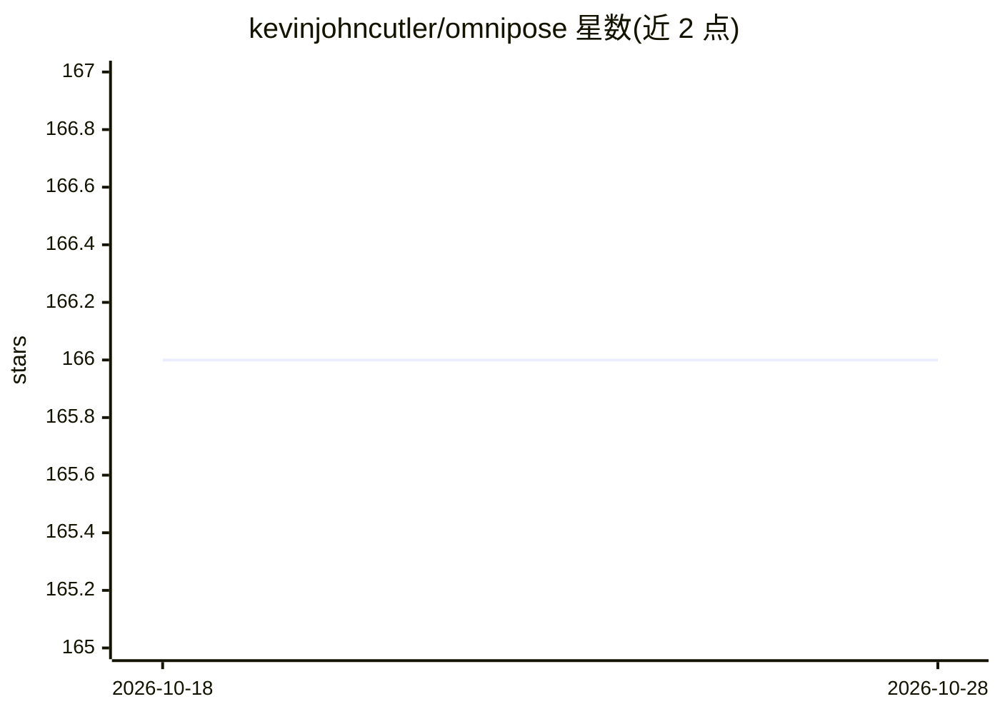

# kevinjohncutler/omnipose

⭐ 166 · Python · NOASSERTION · 推送 2026-09-11 · [GitHub](https://github.com/kevinjohncutler/omnipose) · [官网](https://omnipose.readthedocs.io) · 个人维护

**Omnipose 细胞分割库的精简重构版（进行中）**

Omnipose（显微图像细胞实例分割）代码库的重构工程（README 标注 WIP）：目标是在保持模型行为与输出完全一致的前提下，将代码拆分为核心包 omnipose（ND 优先、向后兼容 API）与工具包 omnitools（绘图/文件管理/变换），并移除未使用的 Cellpose 代码路径。README 仅列出目标、进度清单与模块映射草表；核心 ND 代码移植、GUI 迁移与输出一致性验证尚未完成，仅报告了一次 CPU 上的 parity 对比（掩码一致）。

## 筛选速览

| 维度 | 判定 | 备注 |
|---|---|---|
| AI 角色 | `ai-native` | 本体是模型或模型工具 |
| 许可风险 | `none` | NOASSERTION |
| 部署形态 | `None` |  |
| 模型依赖 | — | README 未给出锁定关系 |
| 硬件要求 | — | 无带数字的原话,不猜 |
| 安装摩擦 | `low` | 无编译、无系统依赖或容器化 |
| 成熟度 | `idea` | |

## 能力要点

- 拆分为 omnipose 核心包与 omnitools 工具包两个可分离包
- 以输出与现有模型完全一致（parity）为重构约束
- ND 优先实现，2D 专用逻辑仅保留轮廓绘图
- 保留 CLI 入口与 GUI 功能为目标（尚未迁移）

## 适用场景

- 跟踪 Omnipose 重构进度与模块映射
- 基于重构后的 ND 优先 API 开发细胞分割流程
- 参考 parity 测试方法做数值一致性验证

## 场景标签

`目标检测` · 领域:感知与多模态

## 证据(README 行号)

> L5: This folder hosts a clean, minimal re-implementation of Omnipose with two separable packages:
> L10: The goal is to preserve all current model behaviors and outputs while simplifying structure and removing unused Cel

## 星数曲线

2026-10-18 166 → 2026-10-28 166（+0）

---
*卡片 v1 · prompt 1.4 · 生成 2026-10-22 · 置信度 mid · 依据 README sha `e70aa56caafb` · [字段定义](../../DATASET.md)*
