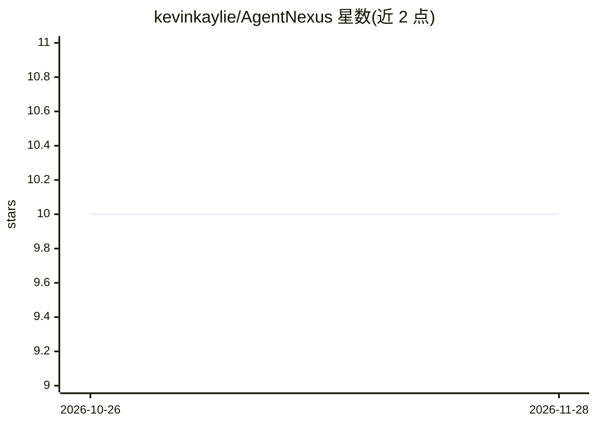

# kevinkaylie/AgentNexus

⭐ 10 · Python · NOASSERTION · 推送 2026-09-23 · [GitHub](https://github.com/kevinkaylie/AgentNexus) · 个人维护 · 中文 README

**给独立 AI Agent 提供身份、发现与可信协作的基础设施框架**

AgentNexus 定义独立运营的 Agent 如何发现彼此、建立 DID 身份、交换证据、协商能力与权限、建立 Session 并留下可审计记录；现有 DID、Relay、Gatekeeper、Enclave、Playbook、Objective Loop 模块作为 RFC 规范层的参考实现。技术栈为 FastAPI + SQLite + PyNaCl，提供 Python SDK 与 MCP 接入（Claude Desktop / Cursor / Claude Code 可通过 MCP 使用）。当前为开发者预览，v1.1 仅承诺 L0 本机 Objective Loop，LAN / Relay 远程 Worker 属于后续版本。

## 筛选速览

| 维度 | 判定 | 备注 |
|---|---|---|
| AI 角色 | `ai-ecosystem` | LLM/agent 周边工具 |
| 许可风险 | `none` | NOASSERTION |
| 部署形态 | `library` | 以包/库形式分发 |
| 模型依赖 | — | README 未给出锁定关系 |
| 硬件要求 | — | 无带数字的原话,不猜 |
| 安装摩擦 | `low` | 无编译、无系统依赖或容器化 |
| 成熟度 | `idea` | |

## 能力要点

- 每个 Agent 拥有 did:agentnexus 多重密钥身份，支持 Owner DID 管理多个子 Agent
- Ed25519 身份验证、X25519 密钥协商、AES-256-GCM 加密通信
- MCP 接入：Claude Desktop / Cursor / Claude Code 可通过 MCP 使用
- Objective Loop：以目标完成为停止条件的自动分派、执行、验收与人工升级机制

## 适用场景

- 多个独立运营的 Agent 之间建立身份与可信协作关系
- 本机多 Agent 团队按 Playbook 分阶段完成开发协作任务
- 通过 MCP 在 Claude Desktop / Cursor 中接入 Agent 通信能力

## 场景标签

`多智能体` `Agent 框架` · 领域:Agent 开发

## 证据(README 行号)

> L21: **Agent Collaboration**，长期探索 **Agent Society**。目标不是再发明一种
> L97: > Agent Collaboration Framework：定义协作参与者、协作语义、证据交换、
> L133: |MCP 与 SDK|Claude Desktop / Cursor / Claude Code 可通过 MCP 使用，Python SDK 支持 async/sync|

## 星数曲线

2026-10-26 10 → 2026-11-28 10（+0）

---
*卡片 v1 · prompt 1.4 · 生成 2026-11-19 · 置信度 high · 依据 README sha `d8e49ad573f2` · [字段定义](../../DATASET.md)*
